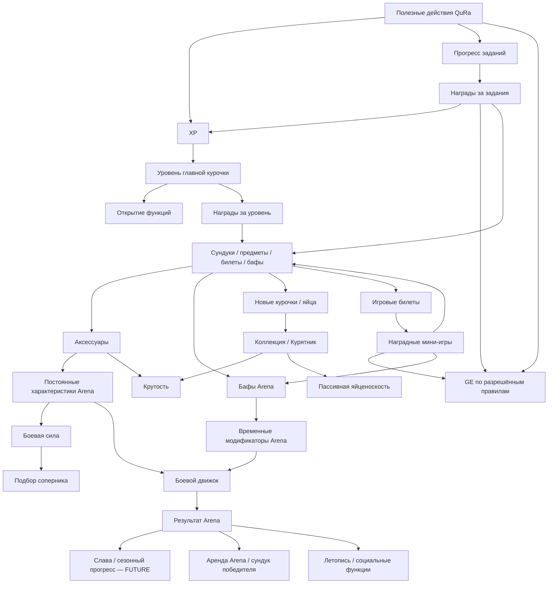
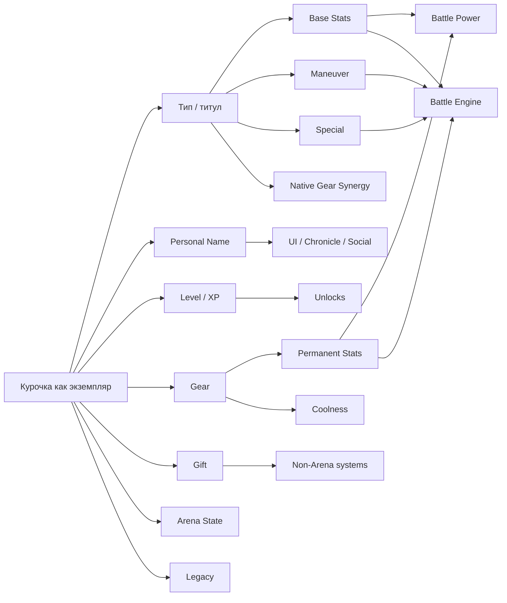
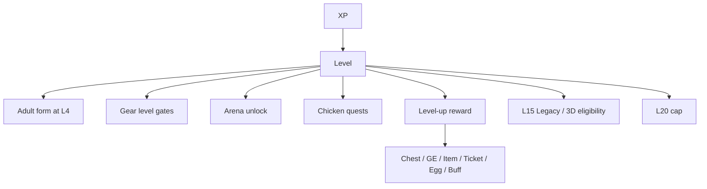
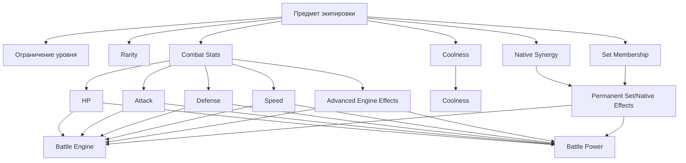
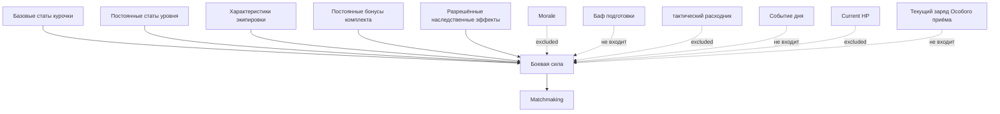
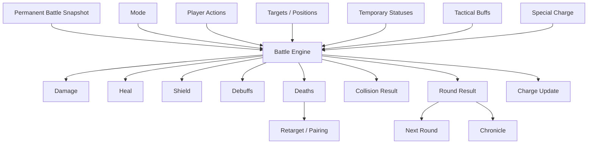
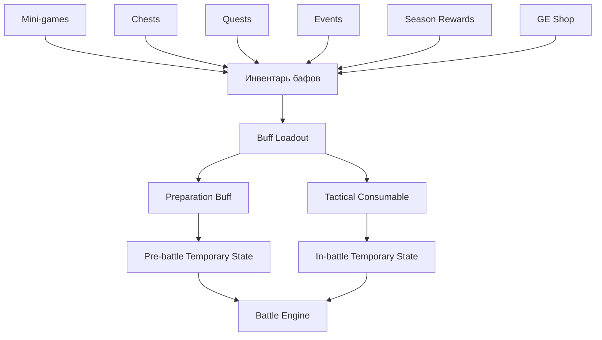
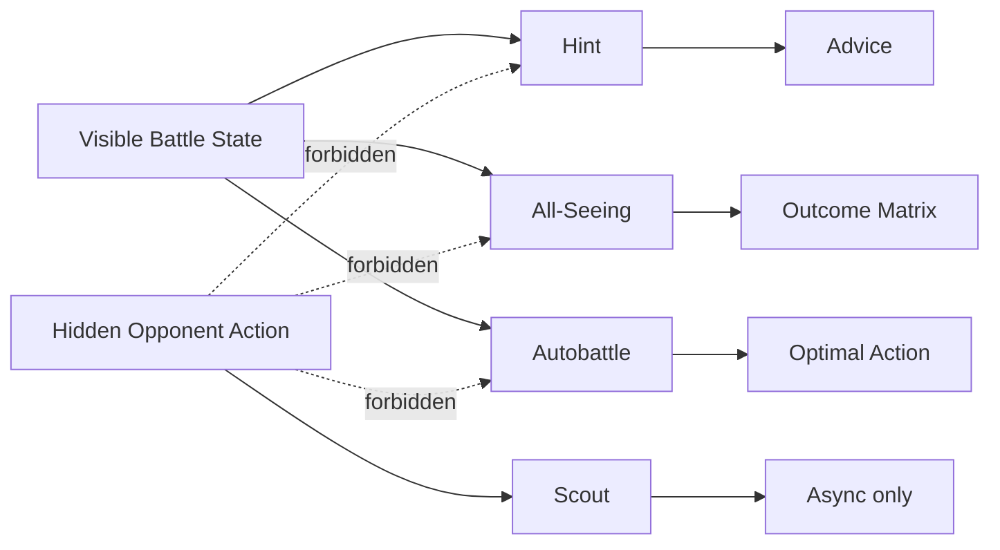
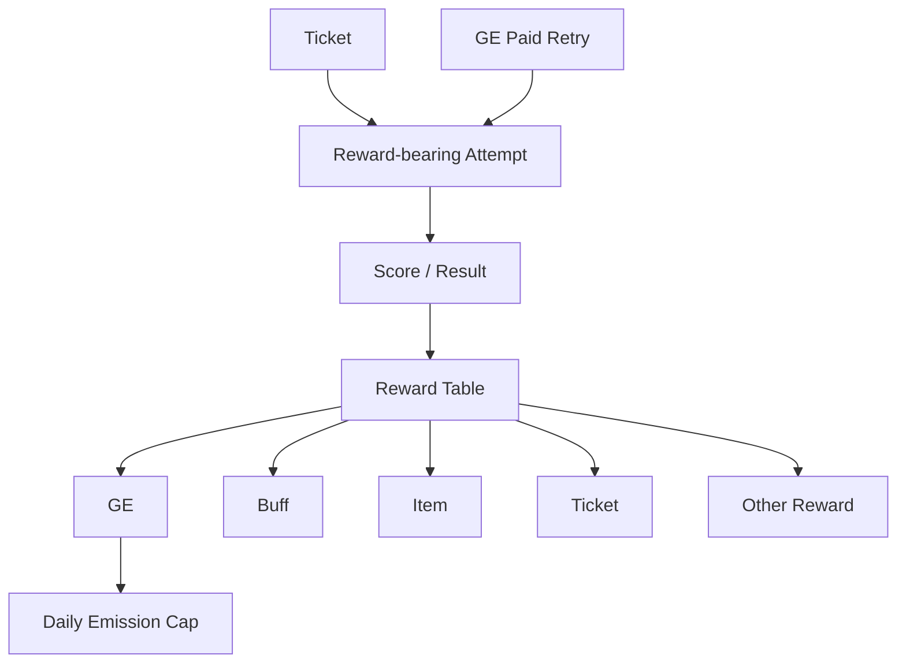
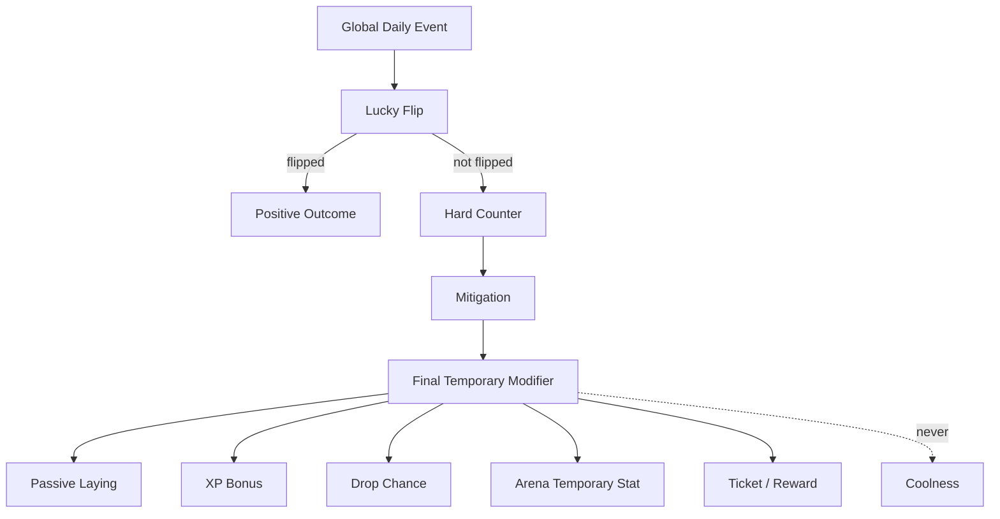

# QuRa — граф игровых зависимостей v1

**Статус:** системная карта зависимостей / второй уровень документации после Game Bible и Arena Spec  
**Дата:** 29.10.2026  
**Источники истины:** `GAME_BIBLE_V1.md`, `ARENA_SPEC_V1.md`  
**Область:** игровые сущности, ресурсы, progression, награды, экипировка, бафы, Arena, события, социальные связи, sinks/faucets и порядок модификаторов.

> Этот документ не вводит новый баланс. Он фиксирует, **кто на что влияет**, какие связи разрешены и какие связи запрещены.

---

# 0. Зачем нужен этот документ

Главная задача Dependency Graph:

- не допустить «мертвых» характеристик;
- не допустить циклов бесконечной выгоды;
- разделить постоянные и временные модификаторы;
- сделать расчёт Боевой силы воспроизводимым;
- сделать экономику GE проверяемой;
- определить порядок обработки эффектов;
- подготовить базу для `GAME_DATA_MODEL.md`;
- показать, какие системы обязаны фиксировать источник, цель и результат.

Главный принцип:

> Любая игровая величина обязана иметь источник, область действия, потребителя и ограничения.

---

# 1. Верхнеуровневая карта QuRa



---

# 2. Два контура: финансовый и игровой

## 2.1. Финансовый контур

Финансовая система может передавать игровой системе подтверждённые события.

Примеры:

- успешное пополнение;
- успешная оплата;
- использование разрешённого сервиса.

Игровая система на их основании может:

- начислить XP;
- закрыть quest;
- выдать награду;
- начислить GE, если это отдельно разрешено экономикой.

Игровая система **не может**:

- менять статус финансовой операции;
- менять курс;
- менять комиссию;
- считать финансовую транзакцию успешной;
- самостоятельно создавать денежный баланс.

## 2.2. GE как мост между контурами

GE имеет двойную роль:

- игровой ресурс;
- действующие бонусные баллы для частичной оплаты ограниченных сервисов QuRa.

Следствие:

> Любой источник выдачи GE в игре имеет экономическую стоимость.

Поэтому каждый источник GE должен фиксировать:

- `source_type`;
- amount;
- timestamp;
- budget/лимит;
- контекст проверки на злоупотребления.

---

## 2.3. Новые межсистемные связи

`Подтверждённая операция QuRa → XP + GE + временный FeedEffect`; `FeedEffect → яйценоскость / Боевой дух / баф подготовки / бонус события`, но **никогда** не Боевая сила. `FeedEvents → CommunityGoal.progress + ClanGoal.progress`. Одно финансовое событие не учитывается дважды благодаря correlation_id. `Участие в клане → приглашения / цели / косметика`, без передачи GE и изменения Боевой силы. `DailyEventChoice → LuckyFlip → защита от угрозы → смягчение → временный результат`; без выбора — вариант по умолчанию. Не создавать вторую валюту «корм».

# 3. Главные игровые ресурсы

## 3.1. XP

### Источники

- задания аккаунта;
- личные задания курочки;
- полезные действия QuRa;
- достижения;
- отдельные события;
- мини-игры и Arena, если это разрешено.

### Получатель

Только главная курочка на момент подтверждённого завершения действия.

### Использование

XP не расходуется.

### Результаты

XP повышает уровень курочки.

Уровень → открытие наград, экипировки и допуска к Arena.

### Запрещено

XP нельзя:

- купить напрямую;
- передать;
- вывести;
- переносить задним числом между курочками.

---

## 3.2. GE

### Источники GE

- мини-игры;
- задания;
- сундуки;
- достижения;
- партнёрская программа;
- пассивное производство, если включено;
- награды Arena;
- events.

### Расходование GE

- экипировка;
- улучшения Курятника;
- платные попытки мини-игр;
- сундуки;
- аренда Arena;
- тактические сервисы Arena;
- preparation бафы;
- tactical расходники;
- будущий cosmetic services.

### Запрет гарантированного прибыльного цикла

Запрещён гарантированный цикл:

`GE spend → action → guaranteed GE > spend`

Любой такой цикл требует EV < cost или hard лимит.

---

## 3.3. Tickets

### Source

- ежедневный accrual: +2/day;
- максимальный запас: 8;
- other explicit награды.

### Consumer

- награда-bearing mini-game attempt.

### Не используется для

- Arena;
- общая навигация;
- Coop.

---

# 4. Курочка как центральная сущность



---

# 5. Тип и личное имя

## Type / title

Определяет:

- базовые характеристики;
- Gift;
- Манёвр;
- Особый приём;
- native экипировка;
- механика персонажа;
- связи с анимациями и историей персонажа.

## Личное имя

Определяет только identity/presentation.

Не влияет на:

- stats;
- BP;
- drop;
- AI;
- редкость;
- награды.

Полное отображаемое имя:

`[Crest] Type PersonalName`

Пример:

`🐺 Профессор Иванов`

---

# 6. Зависимости уровня курочки



Важно:

- уровень itself is not Боевая сила unless it changes постоянный stats;
- порог уровня и значение боевой характеристики — разные понятия;
- предмет высокого уровня может быть сильнее, но само значение уровня не равно боевой силе.

---

# 7. Крутость dependency graph

Крутость = collection/progression status.

Источники:

- LevelScore;
- GearCoolness;
- SetBonus;
- LegacyBonus;
- AchievementBonus;
- бонусы коллекции и Курятника.

Используется для:

- коллекционные рейтинги;
- требования развития Курятника;
- визуальный status;
- achievements.

Не применяется в:

- Arena подбор соперника;
- Battle Engine урон;
- временный combat calculation.

**Hard rule:** Крутость ≠ Боевая сила.

---

# 8. Зависимости Даров

Gift is a постоянный passive identity **outside Arena** unless a specific Arena rule explicitly creates a separate combat effect.

Примеры:

- Ряба → passive laying;
- Гламурочка → магазин discount;
- Дурочка → Lucky Flip;
- Боевик → event protection;
- Монах → synergy amplification;
- Профессор → XP boost.

Дар может влиять на:

- economy;
- events;
- XP;
- магазин;
- синергии Курятника.

Дар не влияет на Arena автоматически.

Так исключается скрытое усиление между игровыми системами.

---

# 9. Экипировка dependency graph



---

# 10. Allowed постоянный combat stats

Основные числовые боевые характеристики:

- HP;
- Атака;
- Защита;
- Скорость.

Продвинутые постоянные эффекты допустимы только при наличии реального механизма боевого движка:

- Щит bonus;
- Лечение bonus;
- Манёвр modifier;
- Особый приём урон;
- Особый приём лечение;
- Особый приём щит;
- Особый приём debuff;
- получение заряда;
- уменьшение заряда;
- next Атака boost/weaken.

Недопустимые неработающие характеристики без нового движка:

- Intelligence;
- Charisma;
- Magic;
- Accuracy;
- Evasion;
- Crit;
- Особый приём Атака;
- Особый приём Защита;
- abstract “Особый приём +10”.

---

# 11. Экипировка design validation chain

Каждая боевая характеристика предмета должна пройти цепочку:

```text
Характеристика предмета
  ↓
Поддерживаемый обработчик движка
  ↓
Реальный боевой расчёт
  ↓
Измеримый вклад характеристики
  ↓
Вес в Боевой силе
  ↓
Балансное ограничение
```

Если хотя бы одно звено отсутствует, характеристику нельзя выпускать.

---

# 12. Зависимости родных предметов

Родная экипировка:

`Gear Type Match → Native Synergy → Permanent Effect → Battle Engine + BP`

Бонус комплекта:

`Equipped Set Threshold → Set Bonus → Permanent Effect → Battle Engine + BP`

Правила:

- родная синергия должна быть описана явно;
- эффекты комплекта должны быть описаны явно;
- никаких скрытых синергий;
- запрет суммирования однотипных эффектов без ограничения.

---

# 13. Боевая сила dependency graph



Боевая сила не определяет результат боя автоматически.

---

# 14. Permanent vs временный modifiers

## Permanent

Сохраняется между боями.

Примеры:

- базовые характеристики;
- уровень-derived stats;
- экипировка;
- бонусы комплектов;
- наследственные модификаторы.

Свойства:

- included in BP;
- persist in DB;
- used in подбор соперника.

## Временные эффекты перед боем

Примеры:

- Preparation баф;
- модификатор Arena от События дня;
- Morale.

Свойства:

- не входит в Боевую силу (BP);
- expire;
- видимость определяется правилами;
- влияет на фактический бой.

## Temporary in-battle

Примеры:

- Щит;
- boost;
- weaken;
- тактический расходник;
- Особый приём charge;
- эффекты текущего раунда.

Свойства:

- не входит в Боевую силу (BP);
- хранится в состоянии боя;
- удаляется или истекает по правилам движка.

---

# 15. Порядок применения модификаторов

Общий порядок применения:

1. базовые характеристики типа;
2. уровень-derived постоянный stats;
3. постоянный экипировка stats;
4. эффекты родных предметов и комплектов;
5. legacy постоянный effects;
6. compute Боевая сила snapshot;
7. подбор соперника;
8. создать снимок состояния боя;
9. применить Боевой дух;
10. применить модификатор События дня;
11. apply Preparation баф;
12. начать бой;
13. применить тактические расходники в допустимый момент;
14. рассчитать действия;
15. apply on-hit/on-урон;
16. применить механики спасения от смерти;
17. применить эффекты конца раунда;
18. expire эффекты текущего раунда.

**Важно:** steps 9–18 do not retroactively change BP.

---

# 16. Зависимости боевого движка Arena



---

# 17. Зависимости боевых действий

## Атака

Зависит от:

- attacker Атака;
- target Защита;
- коэффициент ситуации;
- усиление Атаки;
- ослабление Атаки;
- Щит.

Создаёт:

- урон;
- возможная победа в столкновении;
- charge.

## Защита

Зависит от:

- состояние выбранного действия;
- действие цели и входящая атака;
- defender Защита;
- specific Особый приём rules.

Создаёт:

- reduced урон;
- counterattack;
- charge;
- возможная победа в столкновении.

## Манёвр

Зависит от:

- archetype;
- действие противника;
- уникальный эффект персонажа;
- Скорость in some matchups.

Создаёт сочетания:

- урон;
- Щит;
- лечение;
- boost;
- weaken;
- уменьшение заряда.

## Особый приём

Зависит от:

- charge = 100;
- archetype;
- Защита action interaction;
- логика персонажа.

Создаёт:

- урон;
- лечение;
- щит;
- debuff;
- случайный исход;
- сброс заряда.

---

# 18. Основной треугольник действий

```text
Attack > Maneuver
Maneuver > Defense
Defense > Attack
```

Особый приём находится вне треугольника и обрабатывается по правилам конкретного персонажа.

Эта зависимость важна для:

- action UI;
- Hint;
- All-Seeing;
- Autobattle;
- bot AI;
- асинхронный защита strategy.

Все перечисленные системы используют одну боевую матрицу.

---

# 19. Особый приём Charge dependencies

Источники:

- исход столкновения;
- Защита action;
- экипировка effect;
- эффект бафа;
- эффект персонажа.

Получатели эффектов:

- Особый приём.

Modifiers:

- «Анализ» Профессора;
- будущий экипировка;
- tactical бафы.

Заряд хранится только в состоянии боя.

Not Боевая сила.

---

# 20. Щит dependency

Источники:

- Ряба Манёвр/Особый приём;
- экипировка effects;
- tactical бафы.

Consumes:

- incoming урон.

Ordering:

`Incoming Damage → Shield → HP`

Щит:

- not Защита;
- not постоянный;
- обычно существует только в состоянии боя.

---

# 21. Лечение dependency

Источники:

- Монах;
- tactical бафы;
- экипировка modifiers;
- будущий effects.

Target:

- HP.

Cap:

`HP <= MaxHP`

Лечение cannot create постоянный max HP unless effect explicitly modifies max HP.

---

# 22. Семейства эффектов состояния

Текущие семейства эффектов:

- Щит;
- Атака Boost;
- Атака Weaken;
- Особый приём Charge Reduction.

Для нового статуса нужны:

- источник;
- target;
- duration;
- группа суммирования;
- лимит;
- priority;
- visibility;
- правило завершения действия.

---

# 23. баф system dependency graph



---

# 24. Preparation баф dependency

Примеры:

- HP bonus;
- Защита bonus;
- Скорость bonus;
- Особый приём modifier.

Свойства:

- активируется до боя;
- временный;
- not BP;
- виден после начала боя;
- ограниченная длительность или число матчей.

---

# 25. Зависимости тактических расходников

Источники:

- inventory;
- loadout.

Возможность активации зависит от:

- допустимый момент активации;
- condition;
- область применения;
- остаток расходников;
- допустимость в рейтинговом режиме.

Эффекты могут изменять:

- HP;
- stats;
- Щит;
- Лечение;
- charge;
- targetability;
- доступность действий;
- position;
- survival.

---

# 26. Tactical баф loadout

Рабочая гипотеза:

- коллекция не ограничена правилами конкретного боя;
- боевой набор ограничен;
- ~3 расходники per match;
- один расходник — одно применение;
- как правило, не более одного применения за раунд.

Dependency:

`Инвентарь бафов → Selected Loadout → Match Snapshot → Activation → Consume`

Расходник окончательно списывается только после подтверждения применения сервером.

---

# 27. Comeback баф dependencies

Пример: Double Power.

Eligibility:

`LivingMine = 1 AND LivingEnemy >= 2`

Then:

`Selected Action → Action Multiplier`

Нельзя активировать при невыполненном условии.

Эта проверка должна выполняться сервером.

---

# 28. Зависимости Неуязвимости

Activation:

- допустимая цель;
- допустимый раунд;
- расходник есть в наличии.

Effect:

`Incoming Damage = 0`

Potentially:

`Harmful Secondary Effect = blocked`

Не влияет на:

- Молния богов;
- технический результат сервера.

---

# 29. Positional баф dependencies

Примеры:

- Swap;
- Reformation;
- Intercept.

Они влияют на:

- positions;
- pairings;
- маршрутизацию целей.

Особенно важно для режима «Стенка на стенку».

Эти эффекты рассчитываются **до** определения пар столкновений в раунде.

---

# 30. Зависимости тактических сервисов



---

# 31. Зависимости Подсказки

Читает только:

- visible HP;
- visible Щит;
- видимый заряд Особого приёма;
- количество живых бойцов;
- mode;
- position;
- известные статусы;
- history;
- доступные свои действия;
- known бафы.

Не читает:

- скрытое текущее действие соперника.

Создаёт:

- совет с учётом ситуации.

Обязательна смена стратегии при соотношениях:

- 3×3;
- 3×2;
- 2×1;
- 1×3;
- 1×2;
- 1×1.

---

# 32. Зависимости Всевидящего

Входные данные:

- открытое состояние боя;
- выбранное собственное действие;
- множество допустимых ответных действий соперника.

Uses:

- тот же боевой движок.

Создаёт:

- исходы альтернативных сценариев.

Не получает доступа к реальному скрытому действию.

Это принципиальная граница честности.

---

# 33. Зависимости Автобоя

Входные данные:

- открытое состояние;
- допустимые действия;
- допустимые цели;
- симуляция боевым движком;
- правило оптимизации ожидаемого результата.

Результат:

- одно рекомендованное или выбранное оптимальное действие.

Автобой использует общие правила симуляции с:

- Battle Engine;
- All-Seeing;
- анализ Подсказки.

Формулы не должны дублироваться.

---

# 34. Зависимости Разведки

Входные данные:

- hidden асинхронный defensive action/intent.

Allowed:

- только асинхронная Arena.

Запрещено:

- живой synchronous hidden-turn mode.

---

# 35. Зависимости режима «Стенка на стенку»

Входные данные:

- positions;
- живых бойцов.

Создаёт:

- pairings.

Смерть меняет:

- будущий pairings.

Одна курочка может участвовать в нескольких столкновениях за раунд.

Критическая зависимость:

`One selected action → multiple collision resolutions`

Нужно разделить эффекты на однократные за действие и повторяемые для каждого столкновения.

---

# 36. Зависимости режима JRPG

Входные данные:

- живые бойцы;
- выбранные цели;
- action.

Потенциальные зависимости:

- сосредоточение атак на одной цели;
- Скорость order;
- смерть до выполнения действия;
- правило перенацеливания.

Решения, которые нужно утвердить до выпуска:

- одновременный или последовательный расчёт;
- отмена выбранного действия;
- auto-retarget.

---

# 37. Скорость dependency risk

Текущий прототип:

- affects Атака×Атака;
- affects Манёвр×Манёвр;
- влияет на порядок действий в JRPG.

Возможная проблема:

`Speed ↑ → act earlier → kill target → cancel target action`

This compounds Скорость value.

Before Экипировка Catalog:

- simulate +1 Скорость marginal win rate;
- compare to +1 Атака/Защита/HP;
- зафиксировать модель расчёта;
- only then assign экипировка values/BP weight.

---

# 38. Риск зависимостей при нескольких столкновениях

В режиме «Стенка на стенку» одно действие 1×N может участвовать в нескольких расчётах столкновений.

Каждому эффекту нужна явная область действия:

### Один раз за действие

Возможные примеры:

- self лечение;
- self щит gain;
- сброс заряда;
- однократное расходование бафа;
- next Атака boost consumption.

### Один раз на столкновение

Возможные примеры:

- outgoing урон;
- ослабление конкретной цели;
- результат столкновения.

**OPEN until баланс Arena decision.**

Это нужно решить до выделения общего движка.

---

# 39. Зависимости мини-игр



Mini-game награда must be server-authoritative.

---

# 40. Зависимости сундуков

Из сундука можно получить:

- GE;
- экипировка;
- buff;
- ticket;
- egg/chicken;
- временный bonus.

Содержимое сундука зависит от:

- редкость table;
- прогресс игрока;
- награда pool;
- счётчик гарантии выпадения;
- вместимость инвентаря и переполнение.

Paid сундук must show probabilities.

---

# 41. Зависимости наград

```text
Trigger
  ↓
Reward Definition
  ↓
Eligibility / Feature Gate
  ↓
Server Roll or Fixed Reward
  ↓
Delivery
  ↓
Overflow if needed
  ↓
Audit Log
```

No награда may silently disappear due capacity.

---

# 42. Зависимости Курятника

Вместимость Курятника ограничивает:

- количество экземпляров курочек.

Большее число курочек открывает:

- collection;
- больше Даров;
- больше вариантов команд;
- больше возможностей Arena;
- выше потенциал пассивного производства.

Улучшение Курятника зависит от:

- GE;
- progression;
- Крутость / collection gates.

Does not directly increase Боевая сила.

---

# 43. Пассивная яйценоскость dependency

Входные параметры могут включать:

- взрослые жители;
- уровень/progression;
- Ряба Gift;
- Событие дня;
- разрешённые модификаторы комплектов и эффектов;
- Coop economic лимит.

Результат:

- GE or defined passive награда.

Поскольку GE имеют реальную бонусную стоимость:

- ежедневный лимит required;
- требуется бюджет эмиссии.

---

# 44. Зависимости События дня



---

# 45. Связи Дара и события

Примеры:

- Дурочка Lucky Flip → event outcome;
- Боевик Protection → threat events;
- Монах Grace → synergy bonus;
- Профессор → XP;
- Ряба → laying.

Дары не должны незаметно складываться без правил совместимости семейств.

---

# 46. Зависимости заданий

Области действия заданий:

- ACCOUNT_ONCE;
- CHICKEN_ONCE;
- DAILY_ACCOUNT;
- WEEKLY_ACCOUNT;
- ACHIEVEMENT_ACCOUNT.

Задание использует:

- подтверждённые события;
- progression;
- флаги функций.

Задание выдаёт:

- XP;
- GE;
- сундук;
- buff;
- item;
- ticket;
- achievement/progression.

Нужна проверка доступности функции:

> не создавать задания на отключённую функцию.

---

# 47. Зависимости главной курочки

Главная курочка определяет:

- получателя XP за действие аккаунта в момент его завершения.

Главная курочка не определяет:

- ownership;
- экипировка availability of other chickens;
- активацию Даров жителей;
- состояние коллекции.

Смена главной курочки:

- free;
- будущий XP goes to new main;
- уже полученный XP не переносится.

---

# 48. Зависимости открытия Arena

L4 adult chicken → 1×1 available.

2 adult chickens → 2×2.

3 adult chickens → 3×3.

Season/main ranked format → 3×3 unless changed by Arena rules.

---

# 49. Асинхронный подбор и snapshot (MVP)

Источник: активные `ArenaDefenseSetup`, где курочка L4+, защита **вручную сохранена**, статус не заблокирован. Случайный серверный выбор среди подходящих: уровень атакующей ±2 (**PROTOTYPE BALANCE**) и близкий BP (OPEN). При отсутствии — расширение окна; затем явно помеченный бот с урезанной наградой. Нет рейтинга/Славы/лиги, нет самостоятельного выбора противника.

После подбора `ChickenInstance + Level + Gear + Permanent Stats + BP + DefensePolicyVersion → immutable ArenaFighterSnapshot`. Любое изменение экипировки после snapshot не меняет текущий матч.

Подбор исключает себя, linked accounts по antifraud и чрезмерные повторы одного защитника.

## 49.1. FUTURE — рейтинговый подбор

Будущая рейтинговая система использует одинаковый формат, лигу и BP в рабочем диапазоне ±10% (**PROTOTYPE BALANCE**), расширение окна и явно названного бота. Она не используется в стартовом асинхронном режиме. Слава/лига/сезоны находятся в Future.

---

# 50. Боевой дух

Боевой дух — временный модификатор, не входит в BP. В MVP нет рейтингового алгоритма Слава/лейдербордов. Рейтинг, награды сезонов и влияние Слава — FUTURE.

# 51. FUTURE — Слава

Рейтинговый результат → Слава → лига → сезон → Зал славы. Случайный асинхронный-подбор старта не использует рейтинг. В будущей ranked Arena действует фильтр ±10% BP (PROTOTYPE BALANCE), расширение окна и анти-фарм повторных пар.

---

# 52. Arena: аренда → сундук

`аренда 10 GE с каждого (PROTOTYPE BALANCE) → победа → ArenaPrizeGrant(сундук) → трофей(средний выкуп 7,5 GE) + XP/прогресс + очень редкая непродаваемая косметика`.

При дружеском бою сток 20 − 7,5 = 12,5 GE на пару; в асинхронный (50% побед) 10 − 3,75 = 6,25 GE на попытку. Ни GE-пула, ни прямого GE-приза, ни transfer между игроками.

# 53. Четыре игрока — Future

Стоимость аренды и распределение будущих наград OPEN; старый «пул 80 GE» отменён.


# 54. Таймер: 45 секунд (D-05)

`45s decision (config 30–60) → timeout → автоматическая Защита → consecutiveMisses+1`. Два подряд → Молния богов/техническое поражение. Подтверждённый ход сбрасывает счётчик. Платформенный сбой требует защиты. Массовая Arena — Future.


# 55. Зависимости переподключения

Переподключение влияет на:

- timer;
- фиксацию действий;
- settlement;
- техническое поражение.

Система должна различать:

- отключение игрока;
- сбой платформы.

Сбой платформы не должен незаметно приводить к потере оплаченной аренды.

---

# 56. Зависимости чата

2-player:

- общий чат матча.

4-player:

- All;
- Team;
- Private.

Доступ к данным обеспечивается сервером.

Командные и личные сообщения не передаются клиенту противника.

Чат не влияет на расчёты боя.

---

# 57. Зависимости летописи

Входные данные:

- archetypes;
- personal names;
- crests;
- actions;
- effects;
- бафы;
- deaths;
- результат раунда;
- результат боя.

Outputs:

- литературный рассказ;
- сворачиваемый технический расчёт;
- материал, которым можно поделиться.

Летопись использует **тот же объект результата**, что и боевой движок.

Нельзя заново вычислять факты боя независимо от движка.

---

# 58. Зависимости отображения личности

Отображаемая идентичность:

`Crest + Type + Personal Name`

Пример:

`🐺 Профессор Иванов`

Эта идентичность используется в:

- карточки Arena;
- Chronicle;
- результат боя;
- контекст чата;
- profile/share.

---

# 59. Зависимости наследования

L15 → 3D eligibility.

Embodiment:

- исходная цифровая курочка покидает Курятник;
- освобождается место;
- физический паспорт/идентификатор;
- доступно получение наследника.

Heir:

- new L1;
- наследственный бонус;
- inherited визуальный/gene traits;
- контролируемое ускоренное развитие.

Legacy постоянный combat modifier, if allowed, can affect BP.

---

# 60. Границы инвентаря

## Chest/экипировка inventory

Stores unequipped экипировка.

## баф inventory

Stores tactical/preparation расходники.

## Вместимость для курочек

Ограничено числом мест Курятника.

Это независимые ограничения вместимости.

Нельзя использовать один общий счётчик без определения в модели данных.

---

# 61. Зависимости переполнения

При доставке награды обязательно проверяется вместимость.

If full:

- временный overflow/package;
- решение игрока;
- нет скрытого удаления.

Applies to:

- экипировка;
- chickens;
- other capacity-limited награды.

---

# 62. Флаги функций

Флаги доступности управляют:

- финансовые задания;
- режимы Arena;
- платные сервисы;
- бафы;
- мини-игры;
- категории магазина.

Dependencies:

`Feature OFF → UI hidden/disabled → Quest generator forbidden → Reward references forbidden`

---

# 63. Границы полномочий сервера

Сервер самостоятельно подтверждает:

- XP;
- GE;
- награда rolls;
- tickets;
- уровень;
- inventory;
- фиксация боя;
- результат боя;
- charge;
- бафы;
- расчёт аренды и наград Arena;
- Слава;
- подбор соперника.

Клиент может рассчитывать прогнозы, но итоговое решение принадлежит серверу.

---

# 64. Зависимости аналитики

Every significant state change requires источник context.

Минимальные общие поля события:

- user/account;
- entity;
- источник;
- action;
- amount/value;
- before;
- after;
- timestamp;
- correlation/match/quest id.

Это позволяет:

- аудит экономики;
- анализ баланса;
- anti-fraud;
- восстановление после ошибок.

---

# 65. Зависимости антифрода

Protect:

- GE faucets;
- платные повторы;
- сундук награды;
- награды Arena;
- referrals;
- passive laying;
- achievements.

Client animation/result is not источник of truth.

---

# 66. No hidden cross-system power

Запрещённые примеры:

- Крутость secretly increases Arena урон;
- personal name changes RNG;
- Gift secretly modifies Arena unless documented;
- Daily Event permanently changes экипировка;
- tactical buff changes BP after подбор соперника;
- cosmetic редкость gives hidden combat bonus.

Любое боевое усиление должно иметь явно описанную зависимость.

---

# 67. Источник / расход matrix

| Resource | Main Sources | Main Sinks |
|---|---|---|
| XP | quests, useful actions, achievements, selected game rewards | none |
| GE | mini-games, quests, chests, referrals, Arena payout, passive systems | gear, Coop, attempts, chests, Arena entry, buffs/services |
| Tickets | daily accrual, rewards | mini-game reward attempts |
| Gear | shop, chests, rewards | equip, duplicate disposal/trade-in future |
| Buffs | mini-games, chests, quests, events, shop, seasons | Arena activation |
| Glory | ranked battle, capped defense bonus | season reset/decay rules |
| Coolness | level, gear, collections, legacy, achievements | none |
| Special Charge | battle actions/results | Special |

---

# 68. Permanent/Temporary matrix

| Modifier | Persistent | BP | Battle | Expires |
|---|---:|---:|---:|---|
| Base stats | yes | yes | yes | no |
| Gear stat | yes while equipped | yes | yes | on unequip |
| Set bonus | yes while condition met | yes | yes | condition lost |
| Legacy modifier | yes | if combat | yes | no |
| Morale | no | no | yes | decays |
| Daily Event | no | no | maybe | event expiry |
| Preparation Buff | no | no | yes | duration/N matches |
| Tactical Consumable | no | no | yes | activation/round/battle |
| Shield | no | no | yes | consumed/battle |
| Boost/Weaken | no | no | yes | action/duration |
| Special Charge | no | no | yes | Special/reset |

---

# 69. Battle calculation dependency order

Целевой порядок расчёта в production:

```text
Base archetype stats
→ permanent level stats
→ equipped gear
→ native/set bonuses
→ legacy modifiers
→ Battle Power snapshot
→ matchmaking
→ battle snapshot
→ Morale
→ Daily Event
→ Preparation Buff
→ round start
→ positional buffs
→ tactical pre-action buffs
→ hidden actions
→ action modifiers
→ collision resolution
→ damage/shield/heal
→ on-hit/on-damage
→ survival triggers
→ deaths
→ retarget/pairing update
→ charge
→ end-round effects
→ chronicle
→ battle result
→ Glory / GE settlement
```

---

# 70. Shared Battle Engine consumers

Один детерминированный боевой движок используется для:

- живой Arena;
- асинхронный Arena;
- Training bot;
- All-Seeing preview;
- Autobattle simulation;
- Hint analysis;
- balance simulation;
- replay/chronicle technical reconstruction.

No subsystem may implement a separate урон formula.

---

# 71. Documents produced from this graph

Этот граф непосредственно используется в:

## GAME_DATA_MODEL.md

Необходимы сущности:

- account;
- chicken instance;
- chicken archetype;
- экипировка;
- equipped экипировка;
- buff inventory;
- battle;
- battle participant;
- battle round;
- action;
- status;
- награда;
- quest;
- event;
- ledger.

## ECONOMY_MODEL.md

Needs:

- all GE faucets;
- all GE sinks;
- entry/payout;
- caps;
- EV;
- сундук economy;
- passive emission.

## GEAR_CATALOG.md

Допустимы только утверждённые механизмы боевого движка.

## BUFF_CATALOG.md

Must reference only approved временный hooks.

---

# 72. Open dependency decisions

До окончательного утверждения модели данных:

1. Скорость resolution model.
2. JRPG retarget behavior.
3. Multi-collision once-per-action/once-per-collision semantics.
4. Особый приём charge exact rules.
5. BP weights.
6. Формула Боевого духа.
7. Draw/double-KO GE settlement.
8. Disconnect refund logic.
9. баф loadout exact size.
10. баф перечень разрешённых в рейтинге эффектов.
11. 4-player награда split.
12. Пассивная яйценоскость exact output/лимит.
13. Seventh founder Arena mechanics.

---

# 73. Dependency invariants

Следующие правила действуют всегда.

1. **Крутость never drives подбор соперника.**
2. **Temporary бафы never enter Боевая сила.**
3. **Личное имя never changes mechanics.**
4. **Every экипировка combat stat has an engine hook.**
5. **Every GE faucet has a источник and лимит/budget.**
6. **Every paid activity has settlement/refund rules before production.**
7. **Every hidden action is hidden server-side, not CSS-side.**
8. **All battle simulations use one engine.**
9. **Client is never authoritative for награды or battle outcome.**
10. **Feature-off mechanics cannot appear in quests.**
11. **No награда disappears silently due inventory capacity.**
12. **No same-family modifier stacks infinitely.**
13. **Arena tactical services cannot read hidden живой action.**
14. **Battle Chronicle cannot invent facts not present in engine result.**
15. **No stat exists only for decoration while presented as gameplay-relevant.**

---

# 74. Иерархия источников истины

Единственная иерархия — **DOCUMENTATION_INDEX.md §2**. Здесь описаны зависимости, но не дублируются правила приоритета.


# 75. Состояние комплекта документации

Зависимые документы уже созданы.
- GAME_DATA_MODEL.md
- ECONOMY_MODEL.md
- CHICKEN_CATALOG.md
- GEAR_CATALOG.md
- BUFF_CATALOG.md
- EVENT_CATALOG.md
- QUEST_CATALOG.md
- REWARD_TABLES.md
- SCREENS.md
- ASSET_PRODUCTION.md
- IMPLEMENTATION_ROADMAP.md

See DOCUMENTATION_INDEX.md for the complete map.
