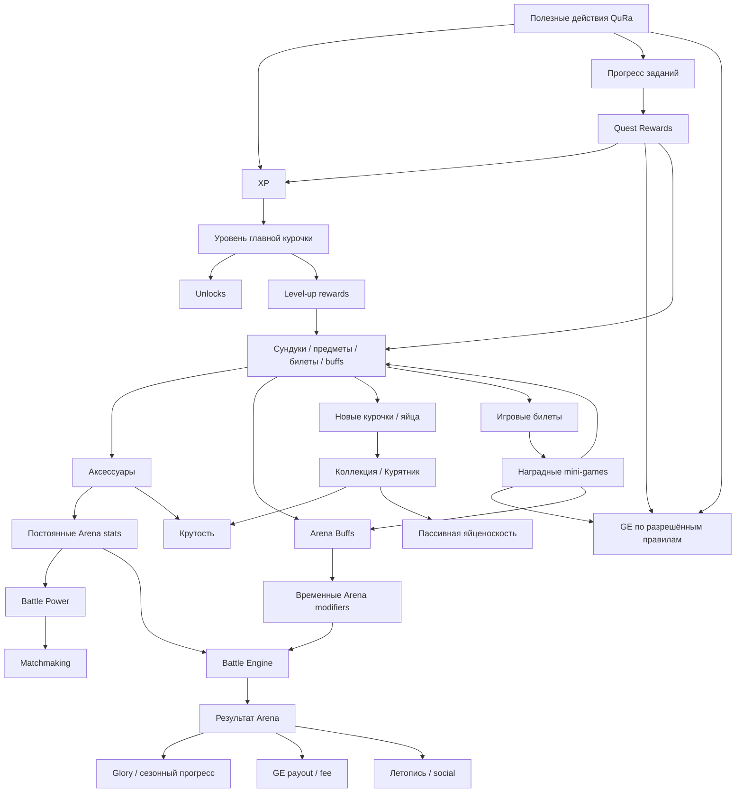
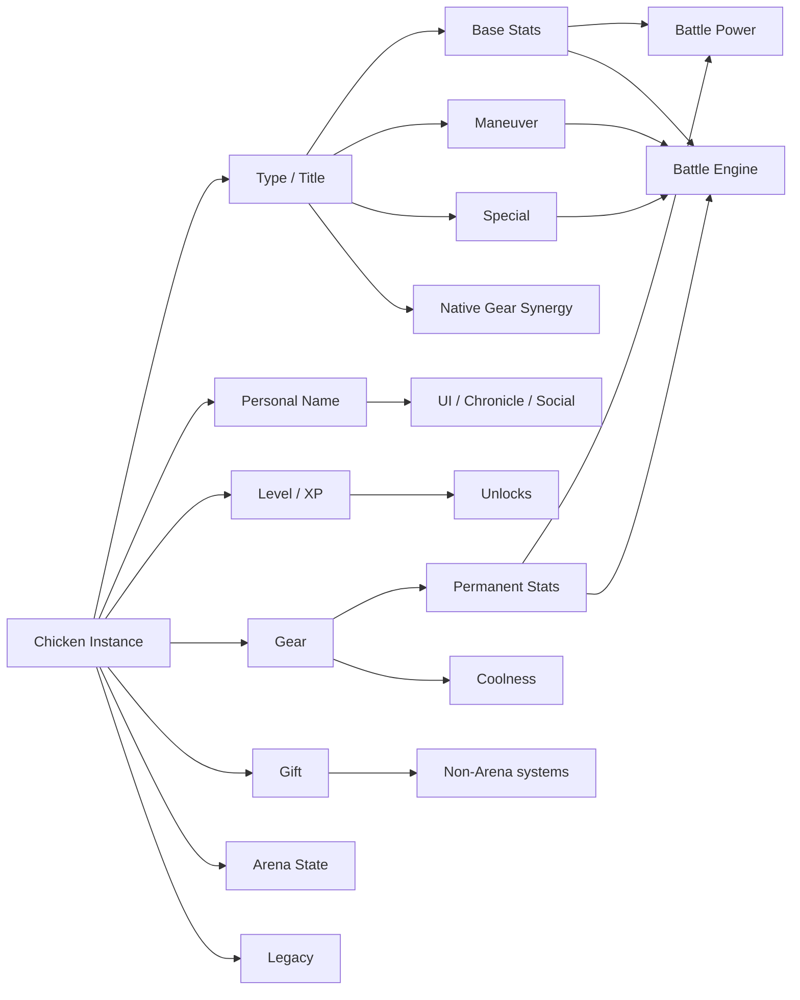
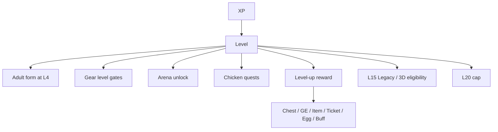
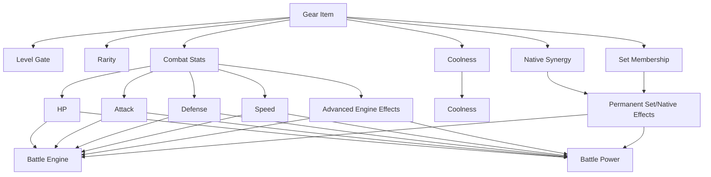
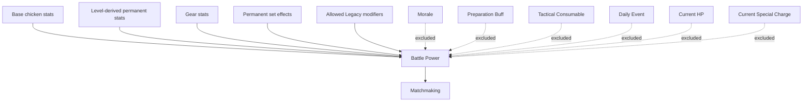
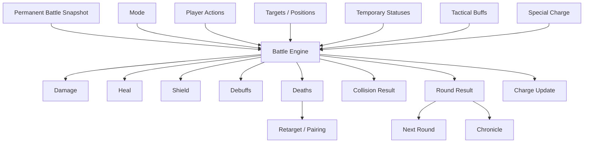
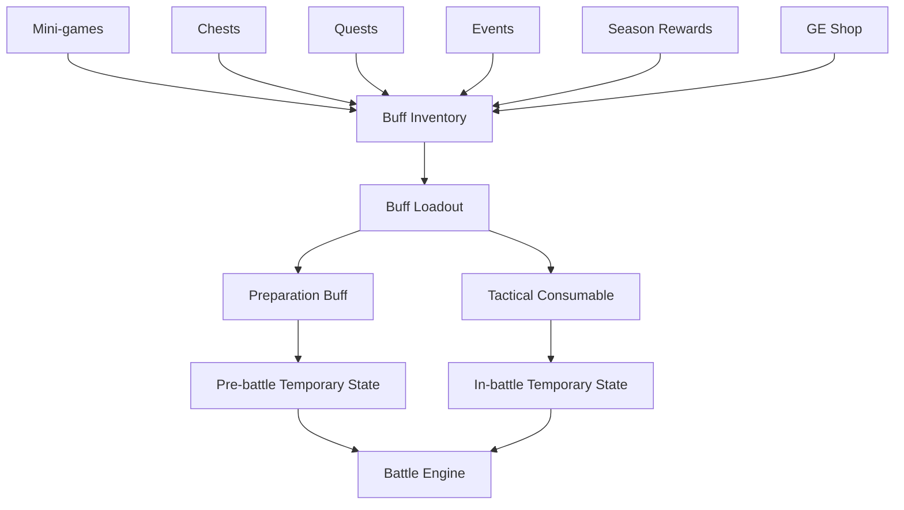
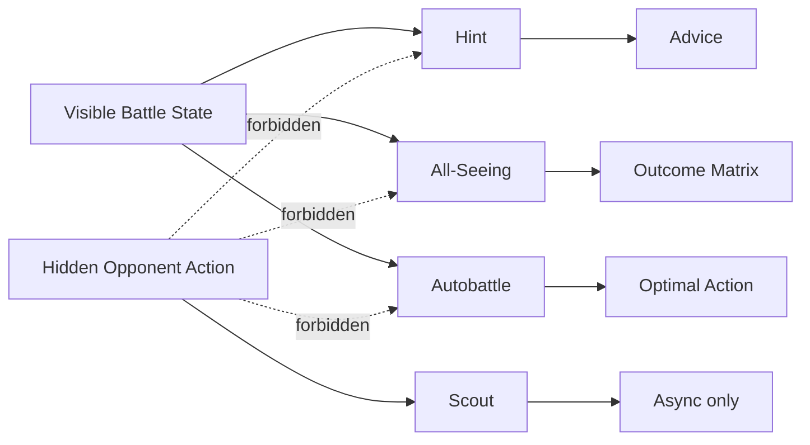
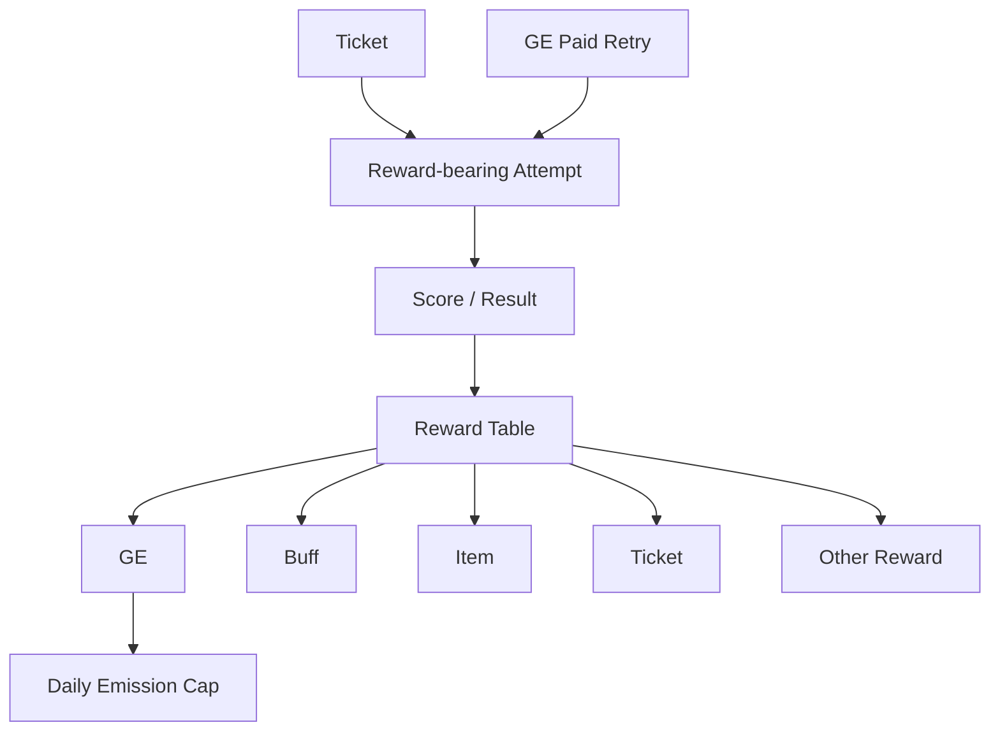
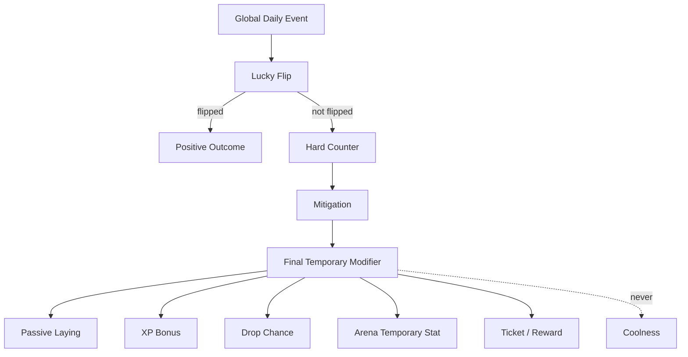

# QuRa — граф игровых зависимостей v1

**Статус:** системная карта зависимостей / второй уровень документации после Game Bible и Arena Spec  
**Дата:** 29.10.2026  
**Источники истины:** `GAME_BIBLE_V1.md`, `ARENA_SPEC_V1.md`  
**Область:** игровые сущности, ресурсы, progression, награды, экипировка, бафы, Arena, события, социальные связи, sinks/faucets и порядок модификаторов.

> Этот документ не вводит новый баланс. Он фиксирует, **кто на что влияет**, какие связи разрешены и какие связи запрещены.

---

# 0. Зачем нужен этот документ

Главная задача Dependency Graph:

- не допустить «мертвых» характеристик;
- не допустить циклов бесконечной выгоды;
- разделить постоянные и временные модификаторы;
- сделать Боевая сила воспроизводимым;
- сделать GE economy аудируемой;
- определить порядок обработки effects;
- подготовить базу для `GAME_DATA_MODEL.md`;
- показать, какие системы обязаны логировать источник/target/result.

Главный принцип:

> Любая игровая величина обязана иметь источник, область действия, потребителя и ограничения.

---

# 1. Верхнеуровневая карта QuRa



---

# 2. Два контура: финансовый и игровой

## 2.1. Финансовый контур

Финансовая система может передавать игровой системе подтверждённые события.

Примеры:

- успешное пополнение;
- успешная оплата;
- использование разрешённого сервиса.

Игровая система на их основании может:

- начислить XP;
- закрыть quest;
- выдать награда;
- начислить GE, если это отдельно разрешено экономикой.

Игровая система **не может**:

- менять статус финансовой операции;
- менять курс;
- менять комиссию;
- считать финансовую транзакцию успешной;
- самостоятельно создавать денежный баланс.

## 2.2. GE как мост между контурами

GE имеет двойную роль:

- игровой ресурс;
- потенциальный бонус/discount resource вне игры.

Следствие:

> Любой GE faucet в игре имеет экономическую стоимость.

Поэтому все GE sources требуют:

- `source_type`;
- amount;
- timestamp;
- budget/лимит;
- anti-fraud context.

---

## 2.3. Новые межсистемные связи

`Confirmed QuRa operation → XP + GE (не меняются) + FeedEffect (temporary)`; `FeedEffect → egg laying / Morale / Preparation Buff / event bonus`, но **никогда** не Боевая сила. `FeedEvents → CommunityGoal.progress + ClanGoal.progress`. Один financial event не учитывается дважды благодаря correlation_id. `Clan membership → invitations/goals/cosmetics`, без GE transfer и combat power. `DailyEventChoice → LuckyFlip → hardCounter → mitigation → temporary result`; без выбора — default option. Не создавать вторую валюту «корм».

# 3. Главные игровые ресурсы

## 3.1. XP

### Sources

- account quests;
- chicken quests;
- полезные действия QuRa;
- achievements;
- отдельные events;
- mini-games / Arena, если разрешено.

### Target

Только главная курочка на момент подтверждённого завершения действия.

### Consumers

XP не расходуется.

### Effects

XP → Level.

Уровень → открытие наград, экипировки и допуска к Arena.

### Forbidden

XP нельзя:

- купить напрямую;
- передать;
- вывести;
- переносить задним числом между курочками.

---

## 3.2. GE

### Faucets

- mini-games;
- quests;
- сундуки;
- achievements;
- partner program;
- passive systems, если включены;
- Arena payout;
- events.

### Sinks

- экипировка;
- Coop upgrades;
- paid mini-game attempts;
- сундуки;
- Arena entry;
- Arena tactical services;
- preparation бафы;
- tactical расходники;
- будущий cosmetic services.

### Critical loop rule

Запрещён гарантированный цикл:

`GE spend → action → guaranteed GE > spend`

Любой такой цикл требует EV < cost или hard лимит.

---

## 3.3. Tickets

### Source

- ежедневный accrual: +2/day;
- max stock: 8;
- other explicit награды.

### Consumer

- награда-bearing mini-game attempt.

### Not used by

- Arena;
- general navigation;
- Coop.

---

# 4. Курочка как центральная сущность



---

# 5. Тип и личное имя

## Type / title

Определяет:

- base stats;
- Gift;
- Манёвр;
- Особый приём;
- native экипировка;
- character mechanics;
- animation/lore hooks.

## Personal name

Определяет только identity/presentation.

Не влияет на:

- stats;
- BP;
- drop;
- AI;
- редкость;
- награды.

Полное отображаемое имя:

`[Crest] Type PersonalName`

Пример:

`🐺 Профессор Иванов`

---

# 6. Зависимости уровня курочки



Важно:

- уровень itself is not Боевая сила unless it changes постоянный stats;
- порог уровня и значение боевой характеристики — разные понятия;
- предмет высокого уровня может быть сильнее, но само значение уровня не равно боевой силе.

---

# 7. Крутость dependency graph

Крутость = collection/progression status.

Источники:

- LevelScore;
- GearCoolness;
- SetBonus;
- LegacyBonus;
- AchievementBonus;
- Coop collection/system bonuses.

Используется для:

- collection rankings;
- Coop progression requirements;
- визуальный status;
- achievements.

Не применяется в:

- Arena подбор соперника;
- Battle Engine урон;
- временный combat calculation.

**Hard rule:** Крутость ≠ Боевая сила.

---

# 8. Gift dependency graph

Gift is a постоянный passive identity **outside Arena** unless a specific Arena rule explicitly creates a separate combat effect.

Примеры:

- Ряба → passive laying;
- Гламурочка → магазин discount;
- Дурочка → Lucky Flip;
- Боевик → event protection;
- Монах → synergy amplification;
- Профессор → XP boost.

Дар может влиять на:

- economy;
- events;
- XP;
- магазин;
- Coop synergies.

Дар не влияет на Arena автоматически.

Так исключается скрытое усиление между игровыми системами.

---

# 9. Экипировка dependency graph



---

# 10. Allowed постоянный combat stats

Основные числовые боевые характеристики:

- HP;
- Атака;
- Защита;
- Скорость.

Продвинутые постоянные эффекты допустимы только при наличии реального механизма боевого движка:

- Щит bonus;
- Лечение bonus;
- Манёвр modifier;
- Особый приём урон;
- Особый приём лечение;
- Особый приём щит;
- Особый приём debuff;
- получение заряда;
- уменьшение заряда;
- next Атака boost/weaken.

Недопустимые неработающие характеристики без нового движка:

- Intelligence;
- Charisma;
- Magic;
- Accuracy;
- Evasion;
- Crit;
- Особый приём Атака;
- Особый приём Защита;
- abstract “Особый приём +10”.

---

# 11. Экипировка design validation chain

Каждая боевая характеристика предмета должна пройти цепочку:

```text
Item property
  ↓
Known engine hook
  ↓
Real battle calculation
  ↓
Measurable marginal effect
  ↓
Battle Power weight
  ↓
Balance cap
```

Если хотя бы одно звено отсутствует, характеристику нельзя выпускать.

---

# 12. Native synergy dependency

Родная экипировка:

`Gear Type Match → Native Synergy → Permanent Effect → Battle Engine + BP`

Set bonus:

`Equipped Set Threshold → Set Bonus → Permanent Effect → Battle Engine + BP`

Правила:

- родная синергия должна быть описана явно;
- эффекты комплекта должны быть описаны явно;
- no invisible synergy;
- no uncapped same-family stacking.

---

# 13. Боевая сила dependency graph



Боевая сила не определяет результат боя автоматически.

---

# 14. Permanent vs временный modifiers

## Permanent

Сохраняется между боями.

Примеры:

- base stats;
- уровень-derived stats;
- экипировка;
- set bonuses;
- Legacy modifiers.

Свойства:

- included in BP;
- persist in DB;
- used in подбор соперника.

## Temporary pre-battle

Примеры:

- Preparation баф;
- Daily Event Arena modifier;
- Morale.

Свойства:

- not included in BP;
- expire;
- visible according to rules;
- affect actual battle.

## Temporary in-battle

Примеры:

- Щит;
- boost;
- weaken;
- tactical consumable;
- Особый приём charge;
- round effects.

Свойства:

- not included in BP;
- stored in battle state;
- cleared/expired by engine rules.

---

# 15. Modifier processing order

Общий порядок применения:

1. base archetype stats;
2. уровень-derived постоянный stats;
3. постоянный экипировка stats;
4. native/set effects;
5. legacy постоянный effects;
6. compute Боевая сила snapshot;
7. подбор соперника;
8. create battle snapshot;
9. apply Morale;
10. apply Daily Event modifier;
11. apply Preparation баф;
12. start battle;
13. apply Tactical Consumables according to activation window;
14. resolve actions;
15. apply on-hit/on-урон;
16. apply survival triggers;
17. apply end-round effects;
18. expire round effects.

**Важно:** steps 9–18 do not retroactively change BP.

---

# 16. Arena Battle Engine dependencies



---

# 17. Зависимости боевых действий

## Атака

Зависит от:

- attacker Атака;
- target Защита;
- contextual multiplier;
- усиление Атаки;
- ослабление Атаки;
- Щит.

Создаёт:

- урон;
- possible collision win;
- charge.

## Защита

Зависит от:

- состояние выбранного действия;
- действие цели и входящая атака;
- defender Защита;
- specific Особый приём rules.

Создаёт:

- reduced урон;
- counterattack;
- charge;
- possible collision win.

## Манёвр

Зависит от:

- archetype;
- opposing action;
- character-specific effect;
- Скорость in some matchups.

Создаёт сочетания:

- урон;
- Щит;
- лечение;
- boost;
- weaken;
- уменьшение заряда.

## Особый приём

Зависит от:

- charge = 100;
- archetype;
- Защита action interaction;
- character logic.

Создаёт:

- урон;
- лечение;
- щит;
- debuff;
- RNG outcome;
- charge reset.

---

# 18. Core combat triangle

```text
Attack > Maneuver
Maneuver > Defense
Defense > Attack
```

Особый приём находится вне треугольника и обрабатывается по правилам конкретного персонажа.

Эта зависимость важна для:

- action UI;
- Hint;
- All-Seeing;
- Autobattle;
- bot AI;
- асинхронный защита strategy.

Все перечисленные системы используют одну боевую матрицу.

---

# 19. Особый приём Charge dependencies

Источники:

- collision result;
- Защита action;
- экипировка effect;
- buff effect;
- character effect.

Получатели эффектов:

- Особый приём.

Modifiers:

- Professor Analysis;
- будущий экипировка;
- tactical бафы.

Заряд хранится только в состоянии боя.

Not Боевая сила.

---

# 20. Щит dependency

Источники:

- Ряба Манёвр/Особый приём;
- экипировка effects;
- tactical бафы.

Consumes:

- incoming урон.

Ordering:

`Incoming Damage → Shield → HP`

Щит:

- not Защита;
- not постоянный;
- usually battle-state.

---

# 21. Лечение dependency

Источники:

- Монах;
- tactical бафы;
- экипировка modifiers;
- будущий effects.

Target:

- HP.

Cap:

`HP <= MaxHP`

Лечение cannot create постоянный max HP unless effect explicitly modifies max HP.

---

# 22. Status dependency families

Текущие семейства эффектов:

- Щит;
- Атака Boost;
- Атака Weaken;
- Особый приём Charge Reduction.

Для нового статуса нужны:

- источник;
- target;
- duration;
- stack group;
- лимит;
- priority;
- visibility;
- cleanup rule.

---

# 23. баф system dependency graph



---

# 24. Preparation баф dependency

Примеры:

- HP bonus;
- Защита bonus;
- Скорость bonus;
- Особый приём modifier.

Свойства:

- активируется до боя;
- временный;
- not BP;
- виден после начала боя;
- limited duration or N matches.

---

# 25. Tactical Consumable dependency

Источники:

- inventory;
- loadout.

Возможность активации зависит от:

- timing window;
- condition;
- target scope;
- remaining inventory;
- ranked legality.

Эффекты могут изменять:

- HP;
- stats;
- Щит;
- Лечение;
- charge;
- targetability;
- action availability;
- position;
- survival.

---

# 26. Tactical баф loadout

Рабочая гипотеза:

- inventory unlimited by battle rules;
- loadout limited;
- ~3 расходники per match;
- one use per item;
- usually max one activation per round.

Dependency:

`Buff Inventory → Selected Loadout → Match Snapshot → Activation → Consume`

Расходник окончательно списывается только после подтверждения применения сервером.

---

# 27. Comeback баф dependencies

Пример: Double Power.

Eligibility:

`LivingMine = 1 AND LivingEnemy >= 2`

Then:

`Selected Action → Action Multiplier`

Нельзя активировать при невыполненном условии.

Эта проверка должна выполняться сервером.

---

# 28. Invulnerability dependency

Activation:

- valid target;
- valid round;
- consumable available.

Effect:

`Incoming Damage = 0`

Potentially:

`Harmful Secondary Effect = blocked`

Не влияет на:

- Gods Lightning;
- server technical result.

---

# 29. Positional баф dependencies

Примеры:

- Swap;
- Reformation;
- Intercept.

These affect:

- positions;
- pairings;
- target routes.

Особенно важно для режима «Стенка на стенку».

They must resolve **before** pairing calculation for the round.

---

# 30. Tactical services dependency graph



---

# 31. Hint dependencies

Reads only:

- visible HP;
- visible Щит;
- visible charge;
- living counts;
- mode;
- position;
- known statuses;
- history;
- own available actions;
- known бафы.

Does not read:

- hidden current enemy action.

Создаёт:

- contextual recommendation.

Обязательна смена стратегии при соотношениях:

- 3×3;
- 3×2;
- 2×1;
- 1×3;
- 1×2;
- 1×1.

---

# 32. All-Seeing dependencies

Входные данные:

- visible battle state;
- selected own action;
- legal opponent action space.

Uses:

- same Battle Engine.

Создаёт:

- counterfactual outcomes.

Не получает доступа к реальному скрытому действию.

Это принципиальная граница честности.

---

# 33. Autobattle dependencies

Входные данные:

- visible state;
- legal actions;
- legal targets;
- Battle Engine simulation;
- expected-value policy.

Результат:

- one recommended/selected optimal move.

Автобой использует общие правила симуляции с:

- Battle Engine;
- All-Seeing;
- Hint analysis.

Формулы не должны дублироваться.

---

# 34. Scout dependencies

Входные данные:

- hidden асинхронный defensive action/intent.

Allowed:

- asynchronous Arena only.

Запрещено:

- живой synchronous hidden-turn mode.

---

# 35. Mode dependency: Wall

Входные данные:

- positions;
- living fighters.

Создаёт:

- pairings.

Death changes:

- будущий pairings.

Одна курочка может участвовать в нескольких столкновениях за раунд.

Критическая зависимость:

`One selected action → multiple collision resolutions`

Нужно разделить эффекты на однократные за действие и повторяемые для каждого столкновения.

---

# 36. Mode dependency: JRPG

Входные данные:

- living fighters;
- selected targets;
- action.

Потенциальные зависимости:

- focus fire;
- Скорость order;
- death before action;
- retarget rule.

Решения, которые нужно утвердить до выпуска:

- simultaneous vs sequential resolution;
- action cancellation;
- auto-retarget.

---

# 37. Скорость dependency risk

Текущий прототип:

- affects Атака×Атака;
- affects Манёвр×Манёвр;
- affects JRPG action ordering.

Возможная проблема:

`Speed ↑ → act earlier → kill target → cancel target action`

This compounds Скорость value.

Before Экипировка Catalog:

- simulate +1 Скорость marginal win rate;
- compare to +1 Атака/Защита/HP;
- lock resolution model;
- only then assign экипировка values/BP weight.

---

# 38. Multi-collision dependency risk

In Wall 1×N, one action may cause multiple collision calls.

Каждому эффекту нужна явная область действия:

### Once per action

Возможные примеры:

- self лечение;
- self щит gain;
- charge reset;
- one-time buff consumption;
- next Атака boost consumption.

### Once per collision

Возможные примеры:

- outgoing урон;
- target-specific debuff;
- collision result.

**OPEN until Arena balance decision.**

Это нужно решить до выделения общего движка.

---

# 39. Mini-game dependency graph



Mini-game награда must be server-authoritative.

---

# 40. Chest dependency graph

Из сундука можно получить:

- GE;
- экипировка;
- buff;
- ticket;
- egg/chicken;
- временный bonus.

Содержимое сундука зависит от:

- редкость table;
- player progression;
- награда pool;
- pity counter;
- inventory capacity/overflow.

Paid сундук must show probabilities.

---

# 41. Reward dependency graph

```text
Trigger
  ↓
Reward Definition
  ↓
Eligibility / Feature Gate
  ↓
Server Roll or Fixed Reward
  ↓
Delivery
  ↓
Overflow if needed
  ↓
Audit Log
```

No награда may silently disappear due capacity.

---

# 42. Coop dependency graph

Вместимость Курятника ограничивает:

- number of chicken instances.

Большее число курочек открывает:

- collection;
- more Gifts;
- more team combinations;
- more Arena options;
- more passive production potential.

Улучшение Курятника зависит от:

- GE;
- progression;
- Крутость / collection gates.

Does not directly increase Боевая сила.

---

# 43. Passive laying dependency

Входные параметры могут включать:

- adult residents;
- уровень/progression;
- Ряба Gift;
- Daily Event;
- allowed set/effect modifiers;
- Coop economic лимит.

Результат:

- GE or defined passive награда.

Поскольку GE имеют реальную бонусную стоимость:

- ежедневный лимит required;
- emission budget required.

---

# 44. Daily Event dependency graph



---

# 45. Gift ↔ Event dependencies

Примеры:

- Дурочка Lucky Flip → event outcome;
- Боевик Protection → threat events;
- Монах Grace → synergy bonus;
- Профессор → XP;
- Ряба → laying.

Дары не должны незаметно складываться без правил совместимости семейств.

---

# 46. Quest dependency graph

Quest scopes:

- ACCOUNT_ONCE;
- CHICKEN_ONCE;
- DAILY_ACCOUNT;
- WEEKLY_ACCOUNT;
- ACHIEVEMENT_ACCOUNT.

Quest reads:

- confirmed events;
- progression;
- feature flags.

Quest outputs:

- XP;
- GE;
- сундук;
- buff;
- item;
- ticket;
- achievement/progression.

Нужна проверка доступности функции:

> no quest for disabled product feature.

---

# 47. Main Chicken dependency

Главная курочка определяет:

- target for account XP at action completion.

Главная курочка не определяет:

- ownership;
- экипировка availability of other chickens;
- Gift activation by residents;
- collection state.

Смена главной курочки:

- free;
- будущий XP goes to new main;
- past XP does not move.

---

# 48. Arena unlock dependency

L4 adult chicken → 1×1 available.

2 adult chickens → 2×2.

3 adult chickens → 3×3.

Season/main ranked format → 3×3 unless changed by Arena rules.

---

# 49. Асинхронный подбор и snapshot (MVP)

Источник: активные `ArenaDefenseSetup`, где курочка L4+, защита **вручную сохранена**, статус не заблокирован. Случайный серверный выбор среди подходящих: уровень атакующей ±2 (**PROTOTYPE BALANCE**) и близкий BP (OPEN). При отсутствии — расширение окна; затем явно помеченный бот с урезанной наградой. Нет рейтинга/Славы/лиги, нет самостоятельного выбора противника.

После подбора `ChickenInstance + Level + Gear + Permanent Stats + BP + DefensePolicyVersion → immutable ArenaFighterSnapshot`. Любое изменение экипировки после snapshot не меняет текущий матч.

Подбор исключает себя, linked accounts по antifraud и чрезмерные повторы одного защитника.

## 49.1. FUTURE — рейтинговый подбор

Будущая рейтинговая система использует одинаковый формат, лигу и BP в рабочем диапазоне ±10% (**PROTOTYPE BALANCE**), расширение окна и явно названного бота. Она не используется в стартовом асинхронном режиме. Слава/лига/сезоны находятся в Future.

---

# 50. Боевой дух

Боевой дух — временный модификатор, не входит в BP. В MVP нет рейтингового алгоритма Слава/лейдербордов. Рейтинг, награды сезонов и влияние Слава — FUTURE.

# 51. FUTURE — Слава

Рейтинговый результат → Слава → лига → сезон → Зал славы. Случайный асинхронный-подбор старта не использует рейтинг. В будущей ranked Arena действует фильтр ±10% BP (PROTOTYPE BALANCE), расширение окна и анти-фарм повторных пар.

---

# 52. Arena: аренда → сундук

`аренда 10 GE с каждого (PROTOTYPE BALANCE) → победа → ArenaPrizeGrant(сундук) → трофей(средний выкуп 7,5 GE) + XP/прогресс + очень редкая непродаваемая косметика`.

При дружеском бою сток 20 − 7,5 = 12,5 GE на пару; в асинхронный (50% побед) 10 − 3,75 = 6,25 GE на попытку. Ни GE-пула, ни прямого GE-приза, ни transfer между игроками.

# 53. Четыре игрока — Future

Стоимость аренды и распределение будущих наград OPEN; старый «пул 80 GE» отменён.


# 54. Таймер: 45 секунд (D-05)

`45s decision (config 30–60) → timeout → автоматическая Защита → consecutiveMisses+1`. Два подряд → Молния богов/техническое поражение. Подтверждённый ход сбрасывает счётчик. Платформенный сбой требует защиты. Массовая Arena — Future.


# 55. Reconnect dependency

Переподключение влияет на:

- timer;
- action lock;
- settlement;
- technical loss.

Система должна различать:

- player disconnect;
- platform failure.

Сбой платформы не должен незаметно приводить к потере оплаченной аренды.

---

# 56. Chat dependency graph

2-player:

- match public chat.

4-player:

- All;
- Team;
- Private.

Доступ к данным обеспечивается сервером.

Командные и личные сообщения не передаются клиенту противника.

Чат не влияет на расчёты боя.

---

# 57. Chronicle dependency graph

Входные данные:

- archetypes;
- personal names;
- crests;
- actions;
- effects;
- бафы;
- deaths;
- round result;
- battle result.

Outputs:

- literary story;
- technical spoiler;
- shareable artifact.

Chronicle must use the **same result object** as Battle Engine.

Нельзя заново вычислять факты боя независимо от движка.

---

# 58. Identity dependency

Отображаемая идентичность:

`Crest + Type + Personal Name`

Пример:

`🐺 Профессор Иванов`

Эта идентичность используется в:

- Arena cards;
- Chronicle;
- battle result;
- chat context;
- profile/share.

---

# 59. Legacy dependency

L15 → 3D eligibility.

Embodiment:

- original digital chicken leaves Coop;
- spot freed;
- physical identifier/passport;
- heir claim possible.

Heir:

- new L1;
- legacy bonus;
- inherited визуальный/gene traits;
- controlled faster progression.

Legacy постоянный combat modifier, if allowed, can affect BP.

---

# 60. Inventory boundaries

## Chest/экипировка inventory

Stores unequipped экипировка.

## баф inventory

Stores tactical/preparation расходники.

## Chicken capacity

Ограничено числом мест Курятника.

Это независимые ограничения вместимости.

Нельзя использовать один общий счётчик без определения в модели данных.

---

# 61. Overflow dependency

При доставке награды обязательно проверяется вместимость.

If full:

- временный overflow/package;
- player decision;
- no silent deletion.

Applies to:

- экипировка;
- chickens;
- other capacity-limited награды.

---

# 62. Feature Flags

Флаги доступности управляют:

- financial quests;
- Arena modes;
- paid services;
- бафы;
- mini-games;
- store categories.

Dependencies:

`Feature OFF → UI hidden/disabled → Quest generator forbidden → Reward references forbidden`

---

# 63. Server authority boundaries

Сервер самостоятельно подтверждает:

- XP;
- GE;
- награда rolls;
- tickets;
- уровень;
- inventory;
- battle lock;
- battle result;
- charge;
- бафы;
- Arena settlement;
- Слава;
- подбор соперника.

Клиент может рассчитывать прогнозы, но итоговое решение принадлежит серверу.

---

# 64. Analytics dependency

Every significant state change requires источник context.

Минимальные общие поля события:

- user/account;
- entity;
- источник;
- action;
- amount/value;
- before;
- after;
- timestamp;
- correlation/match/quest id.

This enables:

- economy audit;
- balance analysis;
- anti-fraud;
- bug recovery.

---

# 65. Anti-fraud dependencies

Protect:

- GE faucets;
- paid retries;
- сундук награды;
- Arena payouts;
- referrals;
- passive laying;
- achievements.

Client animation/result is not источник of truth.

---

# 66. No hidden cross-system power

Запрещённые примеры:

- Крутость secretly increases Arena урон;
- personal name changes RNG;
- Gift secretly modifies Arena unless documented;
- Daily Event permanently changes экипировка;
- tactical buff changes BP after подбор соперника;
- cosmetic редкость gives hidden combat bonus.

Любое боевое усиление должно иметь явно описанную зависимость.

---

# 67. Источник / расход matrix

| Resource | Main Sources | Main Sinks |
|---|---|---|
| XP | quests, useful actions, achievements, selected game rewards | none |
| GE | mini-games, quests, chests, referrals, Arena payout, passive systems | gear, Coop, attempts, chests, Arena entry, buffs/services |
| Tickets | daily accrual, rewards | mini-game reward attempts |
| Gear | shop, chests, rewards | equip, duplicate disposal/trade-in future |
| Buffs | mini-games, chests, quests, events, shop, seasons | Arena activation |
| Glory | ranked battle, capped defense bonus | season reset/decay rules |
| Coolness | level, gear, collections, legacy, achievements | none |
| Special Charge | battle actions/results | Special |

---

# 68. Permanent/Temporary matrix

| Modifier | Persistent | BP | Battle | Expires |
|---|---:|---:|---:|---|
| Base stats | yes | yes | yes | no |
| Gear stat | yes while equipped | yes | yes | on unequip |
| Set bonus | yes while condition met | yes | yes | condition lost |
| Legacy modifier | yes | if combat | yes | no |
| Morale | no | no | yes | decays |
| Daily Event | no | no | maybe | event expiry |
| Preparation Buff | no | no | yes | duration/N matches |
| Tactical Consumable | no | no | yes | activation/round/battle |
| Shield | no | no | yes | consumed/battle |
| Boost/Weaken | no | no | yes | action/duration |
| Special Charge | no | no | yes | Special/reset |

---

# 69. Battle calculation dependency order

Целевой порядок расчёта в production:

```text
Base archetype stats
→ permanent level stats
→ equipped gear
→ native/set bonuses
→ legacy modifiers
→ Battle Power snapshot
→ matchmaking
→ battle snapshot
→ Morale
→ Daily Event
→ Preparation Buff
→ round start
→ positional buffs
→ tactical pre-action buffs
→ hidden actions
→ action modifiers
→ collision resolution
→ damage/shield/heal
→ on-hit/on-damage
→ survival triggers
→ deaths
→ retarget/pairing update
→ charge
→ end-round effects
→ chronicle
→ battle result
→ Glory / GE settlement
```

---

# 70. Shared Battle Engine consumers

Один детерминированный боевой движок используется для:

- живой Arena;
- асинхронный Arena;
- Training bot;
- All-Seeing preview;
- Autobattle simulation;
- Hint analysis;
- balance simulation;
- replay/chronicle technical reconstruction.

No subsystem may implement a separate урон formula.

---

# 71. Documents produced from this graph

Этот граф непосредственно используется в:

## GAME_DATA_MODEL.md

Необходимы сущности:

- account;
- chicken instance;
- chicken archetype;
- экипировка;
- equipped экипировка;
- buff inventory;
- battle;
- battle participant;
- battle round;
- action;
- status;
- награда;
- quest;
- event;
- ledger.

## ECONOMY_MODEL.md

Needs:

- all GE faucets;
- all GE sinks;
- entry/payout;
- caps;
- EV;
- сундук economy;
- passive emission.

## GEAR_CATALOG.md

Допустимы только утверждённые механизмы боевого движка.

## BUFF_CATALOG.md

Must reference only approved временный hooks.

---

# 72. Open dependency decisions

До окончательного утверждения модели данных:

1. Скорость resolution model.
2. JRPG retarget behavior.
3. Multi-collision once-per-action/once-per-collision semantics.
4. Особый приём charge exact rules.
5. BP weights.
6. Morale formula.
7. Draw/double-KO GE settlement.
8. Disconnect refund logic.
9. баф loadout exact size.
10. баф ranked allowlist.
11. 4-player награда split.
12. Passive laying exact output/лимит.
13. Seventh founder Arena mechanics.

---

# 73. Dependency invariants

Следующие правила действуют всегда.

1. **Крутость never drives подбор соперника.**
2. **Temporary бафы never enter Боевая сила.**
3. **Personal name never changes mechanics.**
4. **Every экипировка combat stat has an engine hook.**
5. **Every GE faucet has a источник and лимит/budget.**
6. **Every paid activity has settlement/refund rules before production.**
7. **Every hidden action is hidden server-side, not CSS-side.**
8. **All battle simulations use one engine.**
9. **Client is never authoritative for награды or battle outcome.**
10. **Feature-off mechanics cannot appear in quests.**
11. **No награда disappears silently due inventory capacity.**
12. **No same-family modifier stacks infinitely.**
13. **Arena tactical services cannot read hidden живой action.**
14. **Battle Chronicle cannot invent facts not present in engine result.**
15. **No stat exists only for decoration while presented as gameplay-relevant.**

---

# 74. Иерархия источников истины

Единственная иерархия — **DOCUMENTATION_INDEX.md §2**. Здесь описаны зависимости, но не дублируются правила приоритета.


# 75. Documentation package status

Зависимые документы уже созданы.
- GAME_DATA_MODEL.md
- ECONOMY_MODEL.md
- CHICKEN_CATALOG.md
- GEAR_CATALOG.md
- BUFF_CATALOG.md
- EVENT_CATALOG.md
- QUEST_CATALOG.md
- REWARD_TABLES.md
- SCREENS.md
- ASSET_PRODUCTION.md
- IMPLEMENTATION_ROADMAP.md

See DOCUMENTATION_INDEX.md for the complete map.
