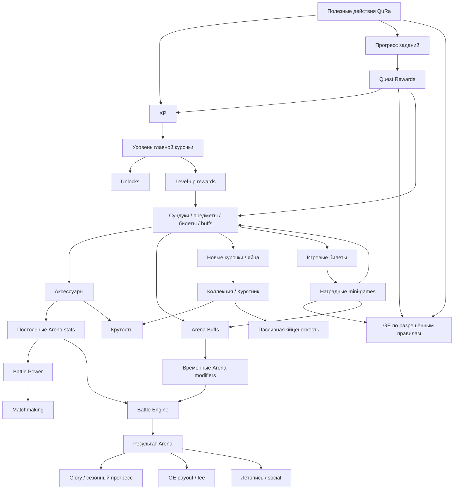
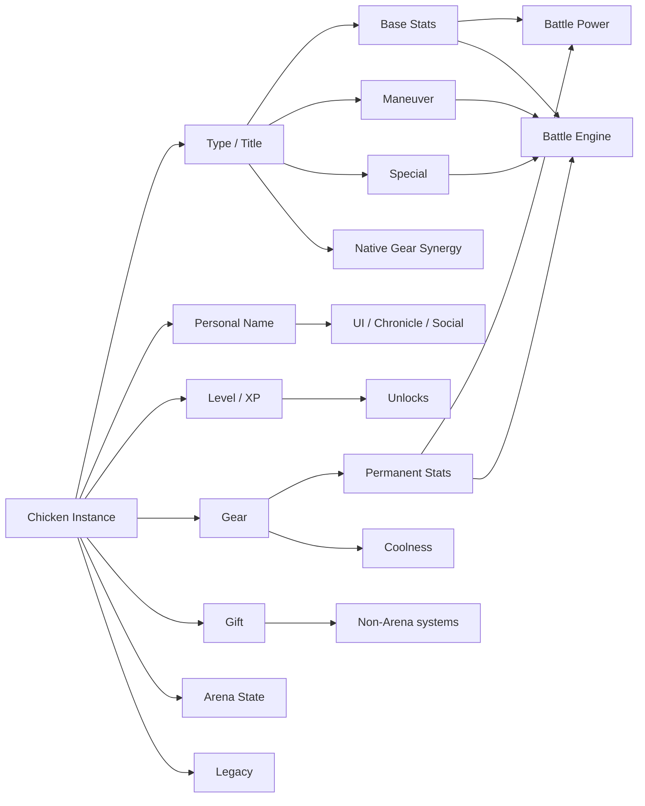
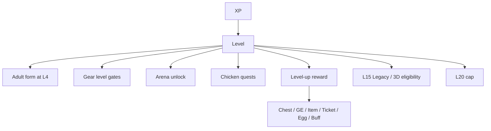
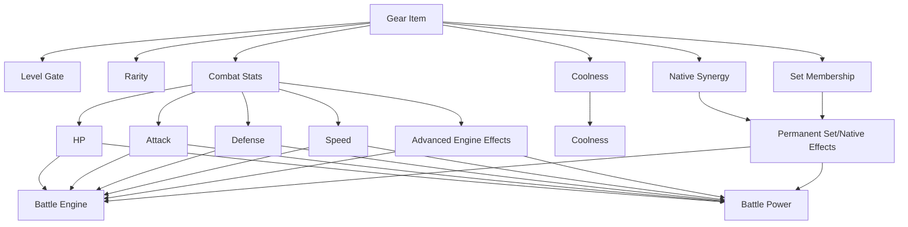
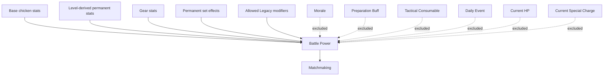
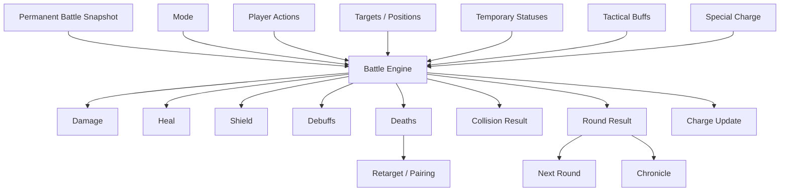
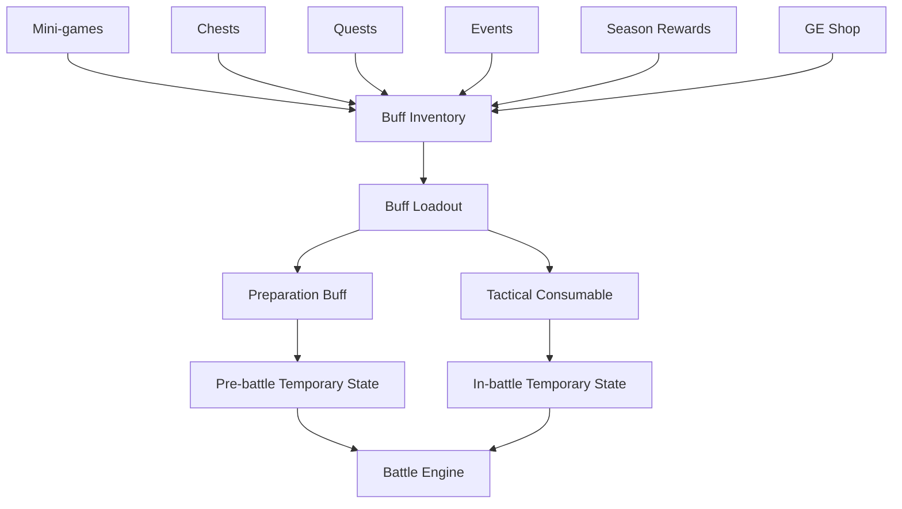
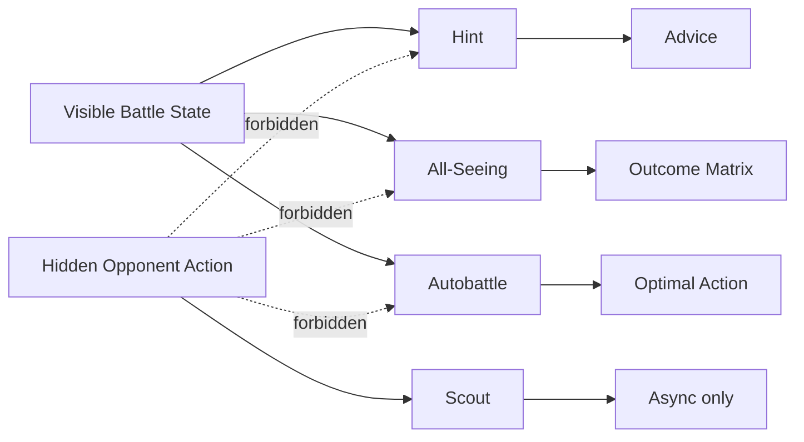
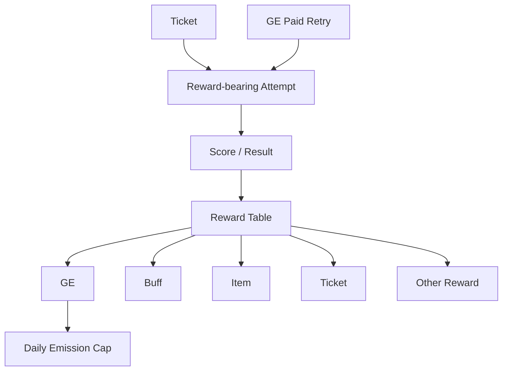
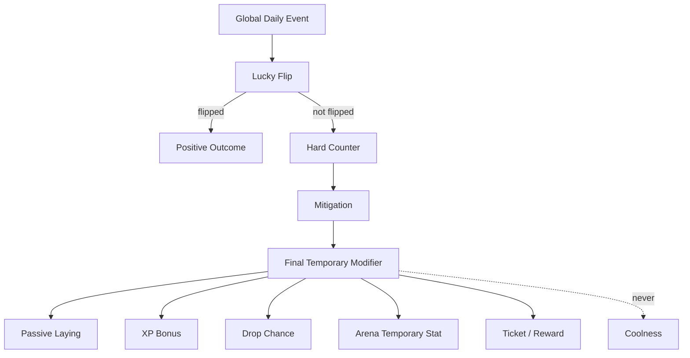

# QuRa Game Dependency Graph v1

**Статус:** системная карта зависимостей / второй уровень документации после Game Bible и Arena Spec  
**Дата:** 29.10.2026  
**Источники истины:** `GAME_BIBLE_V1.md`, `ARENA_SPEC_V1.md`  
**Область:** игровые сущности, ресурсы, progression, rewards, gear, buffs, Arena, события, социальные связи, sinks/faucets и порядок модификаторов.

> Этот документ не вводит новый баланс. Он фиксирует, **кто на что влияет**, какие связи разрешены и какие связи запрещены.

---

# 0. Зачем нужен этот документ

Главная задача Dependency Graph:

- не допустить «мертвых» характеристик;
- не допустить циклов бесконечной выгоды;
- разделить постоянные и временные модификаторы;
- сделать Battle Power воспроизводимым;
- сделать GE economy аудируемой;
- определить порядок обработки effects;
- подготовить базу для `GAME_DATA_MODEL.md`;
- показать, какие системы обязаны логировать source/target/result.

Главный принцип:

> Любая игровая величина обязана иметь источник, область действия, потребителя и ограничения.

---

# 1. Верхнеуровневая карта QuRa



---

# 2. Два контура: финансовый и игровой

## 2.1. Финансовый контур

Финансовая система может передавать игровой системе подтверждённые события.

Примеры:

- успешное пополнение;
- успешная оплата;
- использование разрешённого сервиса.

Игровая система на их основании может:

- начислить XP;
- закрыть quest;
- выдать reward;
- начислить GE, если это отдельно разрешено экономикой.

Игровая система **не может**:

- менять статус финансовой операции;
- менять курс;
- менять комиссию;
- считать финансовую транзакцию успешной;
- самостоятельно создавать денежный баланс.

## 2.2. GE как мост между контурами

GE имеет двойную роль:

- игровой ресурс;
- потенциальный бонус/discount resource вне игры.

Следствие:

> Любой GE faucet в игре имеет экономическую стоимость.

Поэтому все GE sources требуют:

- `source_type`;
- amount;
- timestamp;
- budget/cap;
- anti-fraud context.

---

# 3. Главные игровые ресурсы

## 3.1. XP

### Sources

- account quests;
- chicken quests;
- полезные действия QuRa;
- achievements;
- отдельные events;
- mini-games / Arena, если разрешено.

### Target

Только главная курочка на момент подтверждённого завершения действия.

### Consumers

XP не расходуется.

### Effects

XP → Level.

Level → unlocks, rewards, gear access, Arena access.

### Forbidden

XP нельзя:

- купить напрямую;
- передать;
- вывести;
- переносить задним числом между курочками.

---

## 3.2. GE

### Faucets

- mini-games;
- quests;
- chests;
- achievements;
- partner program;
- passive systems, если включены;
- Arena payout;
- events.

### Sinks

- gear;
- Coop upgrades;
- paid mini-game attempts;
- chests;
- Arena entry;
- Arena tactical services;
- preparation buffs;
- tactical consumables;
- future cosmetic services.

### Critical loop rule

Запрещён гарантированный цикл:

`GE spend → action → guaranteed GE > spend`

Любой такой цикл требует EV < cost или hard cap.

---

## 3.3. Tickets

### Source

- daily accrual: +2/day;
- max stock: 8;
- other explicit rewards.

### Consumer

- reward-bearing mini-game attempt.

### Not used by

- Arena;
- general navigation;
- Coop.

---

# 4. Курочка как центральная сущность



---

# 5. Тип и личное имя

## Type / title

Определяет:

- base stats;
- Gift;
- Maneuver;
- Special;
- native gear;
- character mechanics;
- animation/lore hooks.

## Personal name

Определяет только identity/presentation.

Не влияет на:

- stats;
- BP;
- drop;
- AI;
- rarity;
- rewards.

Full display:

`[Crest] Type PersonalName`

Пример:

`🐺 Профессор Иванов`

---

# 6. Level dependency graph



Important:

- level itself is not Battle Power unless it changes permanent stats;
- level gate and stat value are separate concepts;
- high level item may be stronger, but level number is not automatically combat strength.

---

# 7. Coolness dependency graph

Coolness = collection/progression status.

Sources:

- LevelScore;
- GearCoolness;
- SetBonus;
- LegacyBonus;
- AchievementBonus;
- Coop collection/system bonuses.

Used by:

- collection rankings;
- Coop progression requirements;
- visual status;
- achievements.

Not used by:

- Arena matchmaking;
- Battle Engine damage;
- temporary combat calculation.

**Hard rule:** Coolness ≠ Battle Power.

---

# 8. Gift dependency graph

Gift is a permanent passive identity **outside Arena** unless a specific Arena rule explicitly creates a separate combat effect.

Examples:

- Ряба → passive laying;
- Гламурочка → shop discount;
- Дурочка → Lucky Flip;
- Боевик → event protection;
- Монах → synergy amplification;
- Профессор → XP boost.

Gift can affect:

- economy;
- events;
- XP;
- shop;
- Coop synergies.

Gift does **not automatically** affect Arena.

This prevents hidden cross-system power.

---

# 9. Gear dependency graph



---

# 10. Allowed permanent combat stats

Core numeric stats:

- HP;
- Attack;
- Defense;
- Speed.

Advanced permanent effects are allowed only if tied to real engine hooks:

- Shield bonus;
- Heal bonus;
- Maneuver modifier;
- Special damage;
- Special heal;
- Special shield;
- Special debuff;
- charge gain;
- charge reduction;
- next Attack boost/weaken.

Forbidden as dead stats unless engine exists:

- Intelligence;
- Charisma;
- Magic;
- Accuracy;
- Evasion;
- Crit;
- Special Attack;
- Special Defense;
- abstract “Special +10”.

---

# 11. Gear design validation chain

Every combat stat on item must satisfy:

```text
Item property
  ↓
Known engine hook
  ↓
Real battle calculation
  ↓
Measurable marginal effect
  ↓
Battle Power weight
  ↓
Balance cap
```

If any link is missing → stat cannot ship.

---

# 12. Native synergy dependency

Native gear:

`Gear Type Match → Native Synergy → Permanent Effect → Battle Engine + BP`

Set bonus:

`Equipped Set Threshold → Set Bonus → Permanent Effect → Battle Engine + BP`

Rules:

- native synergy must be explicit;
- set effects must be explicit;
- no invisible synergy;
- no uncapped same-family stacking.

---

# 13. Battle Power dependency graph



Battle Power is not final battle outcome.

---

# 14. Permanent vs temporary modifiers

## Permanent

Persist between battles.

Examples:

- base stats;
- level-derived stats;
- gear;
- set bonuses;
- Legacy modifiers.

Properties:

- included in BP;
- persist in DB;
- used in matchmaking.

## Temporary pre-battle

Examples:

- Preparation Buff;
- Daily Event Arena modifier;
- Morale.

Properties:

- not included in BP;
- expire;
- visible according to rules;
- affect actual battle.

## Temporary in-battle

Examples:

- Shield;
- boost;
- weaken;
- tactical consumable;
- Special charge;
- round effects.

Properties:

- not included in BP;
- stored in battle state;
- cleared/expired by engine rules.

---

# 15. Modifier processing order

High-level ordering:

1. base archetype stats;
2. level-derived permanent stats;
3. permanent gear stats;
4. native/set effects;
5. legacy permanent effects;
6. compute Battle Power snapshot;
7. matchmaking;
8. create battle snapshot;
9. apply Morale;
10. apply Daily Event modifier;
11. apply Preparation Buff;
12. start battle;
13. apply Tactical Consumables according to activation window;
14. resolve actions;
15. apply on-hit/on-damage;
16. apply survival triggers;
17. apply end-round effects;
18. expire round effects.

**Important:** steps 9–18 do not retroactively change BP.

---

# 16. Arena Battle Engine dependencies



---

# 17. Action dependency graph

## Attack

Depends on:

- attacker Attack;
- target Defense;
- contextual multiplier;
- attack boost;
- attack weaken;
- Shield.

Produces:

- damage;
- possible collision win;
- charge.

## Defense

Depends on:

- selected action state;
- target/incoming action;
- defender Defense;
- specific Special rules.

Produces:

- reduced damage;
- counterattack;
- charge;
- possible collision win.

## Maneuver

Depends on:

- archetype;
- opposing action;
- character-specific effect;
- Speed in some matchups.

Produces combinations of:

- damage;
- Shield;
- heal;
- boost;
- weaken;
- charge reduction.

## Special

Depends on:

- charge = 100;
- archetype;
- Defense action interaction;
- character logic.

Produces:

- damage;
- heal;
- shield;
- debuff;
- RNG outcome;
- charge reset.

---

# 18. Core combat triangle

```text
Attack > Maneuver
Maneuver > Defense
Defense > Attack
```

Special is outside the triangle and has character-specific resolution.

This dependency is important for:

- action UI;
- Hint;
- All-Seeing;
- Autobattle;
- bot AI;
- async defense strategy.

All those systems must use the same matrix.

---

# 19. Special Charge dependencies

Sources:

- collision result;
- Defense action;
- gear effect;
- buff effect;
- character effect.

Consumers:

- Special.

Modifiers:

- Professor Analysis;
- future gear;
- tactical buffs.

Charge is battle-state only.

Not Battle Power.

---

# 20. Shield dependency

Sources:

- Ряба Maneuver/Special;
- gear effects;
- tactical buffs.

Consumes:

- incoming damage.

Ordering:

`Incoming Damage → Shield → HP`

Shield:

- not Defense;
- not permanent;
- usually battle-state.

---

# 21. Heal dependency

Sources:

- Монах;
- tactical buffs;
- gear modifiers;
- future effects.

Target:

- HP.

Cap:

`HP <= MaxHP`

Heal cannot create permanent max HP unless effect explicitly modifies max HP.

---

# 22. Status dependency families

Current families:

- Shield;
- Attack Boost;
- Attack Weaken;
- Special Charge Reduction.

Future status requires:

- source;
- target;
- duration;
- stack group;
- cap;
- priority;
- visibility;
- cleanup rule.

---

# 23. Buff system dependency graph



---

# 24. Preparation Buff dependency

Examples:

- HP bonus;
- Defense bonus;
- Speed bonus;
- Special modifier.

Properties:

- activated before match;
- temporary;
- not BP;
- visible after battle starts;
- limited duration or N matches.

---

# 25. Tactical Consumable dependency

Sources:

- inventory;
- loadout.

Activation depends on:

- timing window;
- condition;
- target scope;
- remaining inventory;
- ranked legality.

Effects may alter:

- HP;
- stats;
- Shield;
- Heal;
- charge;
- targetability;
- action availability;
- position;
- survival.

---

# 26. Tactical Buff loadout

Working hypothesis:

- inventory unlimited by battle rules;
- loadout limited;
- ~3 consumables per match;
- one use per item;
- usually max one activation per round.

Dependency:

`Buff Inventory → Selected Loadout → Match Snapshot → Activation → Consume`

Item should only be permanently consumed after server accepts activation.

---

# 27. Comeback Buff dependencies

Example: Double Power.

Eligibility:

`LivingMine = 1 AND LivingEnemy >= 2`

Then:

`Selected Action → Action Multiplier`

Cannot activate if condition false.

This pattern must be server-side.

---

# 28. Invulnerability dependency

Activation:

- valid target;
- valid round;
- consumable available.

Effect:

`Incoming Damage = 0`

Potentially:

`Harmful Secondary Effect = blocked`

Does not affect:

- Gods Lightning;
- server technical result.

---

# 29. Positional Buff dependencies

Examples:

- Swap;
- Reformation;
- Intercept.

These affect:

- positions;
- pairings;
- target routes.

Especially important in Wall mode.

They must resolve **before** pairing calculation for the round.

---

# 30. Tactical services dependency graph



---

# 31. Hint dependencies

Reads only:

- visible HP;
- visible Shield;
- visible charge;
- living counts;
- mode;
- position;
- known statuses;
- history;
- own available actions;
- known buffs.

Does not read:

- hidden current enemy action.

Produces:

- contextual recommendation.

Must switch strategy for:

- 3×3;
- 3×2;
- 2×1;
- 1×3;
- 1×2;
- 1×1.

---

# 32. All-Seeing dependencies

Input:

- visible battle state;
- selected own action;
- legal opponent action space.

Uses:

- same Battle Engine.

Produces:

- counterfactual outcomes.

Does not access actual hidden action.

This is essential fairness boundary.

---

# 33. Autobattle dependencies

Input:

- visible state;
- legal actions;
- legal targets;
- Battle Engine simulation;
- expected-value policy.

Output:

- one recommended/selected optimal move.

Autobattle must share simulation rules with:

- Battle Engine;
- All-Seeing;
- Hint analysis.

No duplicate formulas.

---

# 34. Scout dependencies

Input:

- hidden async defensive action/intent.

Allowed:

- asynchronous Arena only.

Forbidden:

- live synchronous hidden-turn mode.

---

# 35. Mode dependency: Wall

Inputs:

- positions;
- living fighters.

Produces:

- pairings.

Death changes:

- future pairings.

One fighter may map to multiple collisions.

Critical dependency:

`One selected action → multiple collision resolutions`

Need once-per-action vs once-per-collision rules.

---

# 36. Mode dependency: JRPG

Inputs:

- living fighters;
- selected targets;
- action.

Potential dependencies:

- focus fire;
- Speed order;
- death before action;
- retarget rule.

Open production decisions:

- simultaneous vs sequential resolution;
- action cancellation;
- auto-retarget.

---

# 37. Speed dependency risk

Current prototype:

- affects Attack×Attack;
- affects Maneuver×Maneuver;
- affects JRPG action ordering.

Potential problem:

`Speed ↑ → act earlier → kill target → cancel target action`

This compounds Speed value.

Before Gear Catalog:

- simulate +1 Speed marginal win rate;
- compare to +1 Attack/Defense/HP;
- lock resolution model;
- only then assign gear values/BP weight.

---

# 38. Multi-collision dependency risk

In Wall 1×N, one action may cause multiple collision calls.

Need explicit scope for each effect:

### Once per action

Candidate examples:

- self heal;
- self shield gain;
- charge reset;
- one-time buff consumption;
- next Attack boost consumption.

### Once per collision

Candidate examples:

- outgoing damage;
- target-specific debuff;
- collision result.

**OPEN until Arena balance decision.**

This must be resolved before implementation extraction.

---

# 39. Mini-game dependency graph



Mini-game reward must be server-authoritative.

---

# 40. Chest dependency graph

Chest can produce:

- GE;
- gear;
- buff;
- ticket;
- egg/chicken;
- temporary bonus.

Chest depends on:

- rarity table;
- player progression;
- reward pool;
- pity counter;
- inventory capacity/overflow.

Paid chest must show probabilities.

---

# 41. Reward dependency graph

```text
Trigger
  ↓
Reward Definition
  ↓
Eligibility / Feature Gate
  ↓
Server Roll or Fixed Reward
  ↓
Delivery
  ↓
Overflow if needed
  ↓
Audit Log
```

No reward may silently disappear due capacity.

---

# 42. Coop dependency graph

Coop capacity controls:

- number of chicken instances.

More chickens enable:

- collection;
- more Gifts;
- more team combinations;
- more Arena options;
- more passive production potential.

Coop upgrade depends on:

- GE;
- progression;
- Coolness / collection gates.

Does not directly increase Battle Power.

---

# 43. Passive laying dependency

Inputs may include:

- adult residents;
- level/progression;
- Ряба Gift;
- Daily Event;
- allowed set/effect modifiers;
- Coop economic cap.

Output:

- GE or defined passive reward.

Because GE has real value:

- daily cap required;
- emission budget required.

---

# 44. Daily Event dependency graph



---

# 45. Gift ↔ Event dependencies

Examples:

- Дурочка Lucky Flip → event outcome;
- Боевик Protection → threat events;
- Монах Grace → synergy bonus;
- Профессор → XP;
- Ряба → laying.

Gift should not silently stack without family rule.

---

# 46. Quest dependency graph

Quest scopes:

- ACCOUNT_ONCE;
- CHICKEN_ONCE;
- DAILY_ACCOUNT;
- WEEKLY_ACCOUNT;
- ACHIEVEMENT_ACCOUNT.

Quest reads:

- confirmed events;
- progression;
- feature flags.

Quest outputs:

- XP;
- GE;
- chest;
- buff;
- item;
- ticket;
- achievement/progression.

Feature gate required:

> no quest for disabled product feature.

---

# 47. Main Chicken dependency

Main Chicken determines:

- target for account XP at action completion.

Does not determine:

- ownership;
- gear availability of other chickens;
- Gift activation by residents;
- collection state.

Switching Main Chicken:

- free;
- future XP goes to new main;
- past XP does not move.

---

# 48. Arena unlock dependency

L4 adult chicken → 1×1 available.

2 adult chickens → 2×2.

3 adult chickens → 3×3.

Season/main ranked format → 3×3 unless changed by Arena rules.

---

# 49. Matchmaking dependency

Inputs:

- format;
- league/rating;
- Battle Power;
- anti-farm history;
- availability.

Excluded:

- temporary buff;
- Morale;
- Daily Event;
- current HP;
- charge.

Output:

- opponent/match.

Then server creates immutable battle snapshot.

---

# 50. Morale dependency

Sources:

- win/loss streaks;
- decay toward 0.

Affects:

- temporary battle effectiveness.

Excluded from:

- BP.

Visible:

- opponent sees positive/negative state.

Exact formula belongs Economy/Arena balance.

---

# 51. Glory dependency

Sources:

- ranked results;
- limited async defense bonus.

Depends on:

- opponent rating;
- result;
- anti-farm coefficient;
- season rules.

Not sourced by:

- Friendly;
- Training.

Outputs:

- league;
- leaderboard;
- Hall of Fame;
- season reward eligibility.

---

# 52. Arena: аренда → сундук

`аренда 10 GE с каждого (PROTOTYPE BALANCE) → победа → ArenaPrizeGrant(сундук) → трофей(средний выкуп 7,5 GE) + XP/прогресс + очень редкая непродаваемая косметика`.

При дружеском бою сток 20 − 7,5 = 12,5 GE на пару; в async (50% побед) 10 − 3,75 = 6,25 GE на попытку. Ни GE-пула, ни прямого GE-приза, ни transfer между игроками.

# 53. Четыре игрока — Future

Стоимость аренды и распределение будущих наград OPEN; старый «пул 80 GE» отменён.


# 54. Таймер: 45 секунд (D-05)

`45s decision (config 30–60) → timeout → автоматическая Защита → consecutiveMisses+1`. Два подряд → Молния богов/техническое поражение. Подтверждённый ход сбрасывает счётчик. Платформенный сбой требует защиты. Массовая Arena — Future.


# 55. Reconnect dependency

Reconnect affects:

- timer;
- action lock;
- settlement;
- technical loss.

Production must distinguish:

- player disconnect;
- platform failure.

Platform failure must not silently create paid loss.

---

# 56. Chat dependency graph

2-player:

- match public chat.

4-player:

- All;
- Team;
- Private.

Visibility is server-enforced.

Team/private message must not be delivered to enemy client.

Chat does not affect Battle Engine.

---

# 57. Chronicle dependency graph

Inputs:

- archetypes;
- personal names;
- crests;
- actions;
- effects;
- buffs;
- deaths;
- round result;
- battle result.

Outputs:

- literary story;
- technical spoiler;
- shareable artifact.

Chronicle must use the **same result object** as Battle Engine.

Never regenerate battle facts independently.

---

# 58. Identity dependency

Display identity:

`Crest + Type + Personal Name`

Example:

`🐺 Профессор Иванов`

This identity appears in:

- Arena cards;
- Chronicle;
- battle result;
- chat context;
- profile/share.

---

# 59. Legacy dependency

L15 → 3D eligibility.

Embodiment:

- original digital chicken leaves Coop;
- spot freed;
- physical identifier/passport;
- heir claim possible.

Heir:

- new L1;
- legacy bonus;
- inherited visual/gene traits;
- controlled faster progression.

Legacy permanent combat modifier, if allowed, can affect BP.

---

# 60. Inventory boundaries

## Chest/gear inventory

Stores unequipped gear.

## Buff inventory

Stores tactical/preparation consumables.

## Chicken capacity

Controlled by Coop slots.

These are different capacities.

Do not reuse one generic count without explicit data model.

---

# 61. Overflow dependency

Reward delivery must check capacity.

If full:

- temporary overflow/package;
- player decision;
- no silent deletion.

Applies to:

- gear;
- chickens;
- other capacity-limited rewards.

---

# 62. Feature Flags

Feature flags gate:

- financial quests;
- Arena modes;
- paid services;
- buffs;
- mini-games;
- store categories.

Dependencies:

`Feature OFF → UI hidden/disabled → Quest generator forbidden → Reward references forbidden`

---

# 63. Server authority boundaries

Server authoritative for:

- XP;
- GE;
- reward rolls;
- tickets;
- level;
- inventory;
- battle lock;
- battle result;
- charge;
- buffs;
- Arena settlement;
- Glory;
- matchmaking.

Client may calculate previews, but server result is authoritative.

---

# 64. Analytics dependency

Every significant state change requires source context.

Minimum generic event fields:

- user/account;
- entity;
- source;
- action;
- amount/value;
- before;
- after;
- timestamp;
- correlation/match/quest id.

This enables:

- economy audit;
- balance analysis;
- anti-fraud;
- bug recovery.

---

# 65. Anti-fraud dependencies

Protect:

- GE faucets;
- paid retries;
- chest rewards;
- Arena payouts;
- referrals;
- passive laying;
- achievements.

Client animation/result is not source of truth.

---

# 66. No hidden cross-system power

Forbidden examples:

- Coolness secretly increases Arena damage;
- personal name changes RNG;
- Gift secretly modifies Arena unless documented;
- Daily Event permanently changes gear;
- tactical buff changes BP after matchmaking;
- cosmetic rarity gives hidden combat bonus.

All combat power must have explicit dependency.

---

# 67. Source/Sink matrix

| Resource | Main Sources | Main Sinks |
|---|---|---|
| XP | quests, useful actions, achievements, selected game rewards | none |
| GE | mini-games, quests, chests, referrals, Arena payout, passive systems | gear, Coop, attempts, chests, Arena entry, buffs/services |
| Tickets | daily accrual, rewards | mini-game reward attempts |
| Gear | shop, chests, rewards | equip, duplicate disposal/trade-in future |
| Buffs | mini-games, chests, quests, events, shop, seasons | Arena activation |
| Glory | ranked battle, capped defense bonus | season reset/decay rules |
| Coolness | level, gear, collections, legacy, achievements | none |
| Special Charge | battle actions/results | Special |

---

# 68. Permanent/Temporary matrix

| Modifier | Persistent | BP | Battle | Expires |
|---|---:|---:|---:|---|
| Base stats | yes | yes | yes | no |
| Gear stat | yes while equipped | yes | yes | on unequip |
| Set bonus | yes while condition met | yes | yes | condition lost |
| Legacy modifier | yes | if combat | yes | no |
| Morale | no | no | yes | decays |
| Daily Event | no | no | maybe | event expiry |
| Preparation Buff | no | no | yes | duration/N matches |
| Tactical Consumable | no | no | yes | activation/round/battle |
| Shield | no | no | yes | consumed/battle |
| Boost/Weaken | no | no | yes | action/duration |
| Special Charge | no | no | yes | Special/reset |

---

# 69. Battle calculation dependency order

Target production order:

```text
Base archetype stats
→ permanent level stats
→ equipped gear
→ native/set bonuses
→ legacy modifiers
→ Battle Power snapshot
→ matchmaking
→ battle snapshot
→ Morale
→ Daily Event
→ Preparation Buff
→ round start
→ positional buffs
→ tactical pre-action buffs
→ hidden actions
→ action modifiers
→ collision resolution
→ damage/shield/heal
→ on-hit/on-damage
→ survival triggers
→ deaths
→ retarget/pairing update
→ charge
→ end-round effects
→ chronicle
→ battle result
→ Glory / GE settlement
```

---

# 70. Shared Battle Engine consumers

The same deterministic Battle Engine must serve:

- live Arena;
- async Arena;
- Training bot;
- All-Seeing preview;
- Autobattle simulation;
- Hint analysis;
- balance simulation;
- replay/chronicle technical reconstruction.

No subsystem may implement a separate damage formula.

---

# 71. Documents produced from this graph

This graph directly feeds:

## GAME_DATA_MODEL.md

Needs entities for:

- account;
- chicken instance;
- chicken archetype;
- gear;
- equipped gear;
- buff inventory;
- battle;
- battle participant;
- battle round;
- action;
- status;
- reward;
- quest;
- event;
- ledger.

## ECONOMY_MODEL.md

Needs:

- all GE faucets;
- all GE sinks;
- entry/payout;
- caps;
- EV;
- chest economy;
- passive emission.

## GEAR_CATALOG.md

Must reference only approved combat hooks.

## BUFF_CATALOG.md

Must reference only approved temporary hooks.

---

# 72. Open dependency decisions

Before production data model is frozen:

1. Speed resolution model.
2. JRPG retarget behavior.
3. Multi-collision once-per-action/once-per-collision semantics.
4. Special charge exact rules.
5. BP weights.
6. Morale formula.
7. Draw/double-KO GE settlement.
8. Disconnect refund logic.
9. Buff loadout exact size.
10. Buff ranked allowlist.
11. 4-player reward split.
12. Passive laying exact output/cap.
13. Seventh founder Arena mechanics.

---

# 73. Dependency invariants

These must always remain true.

1. **Coolness never drives matchmaking.**
2. **Temporary buffs never enter Battle Power.**
3. **Personal name never changes mechanics.**
4. **Every gear combat stat has an engine hook.**
5. **Every GE faucet has a source and cap/budget.**
6. **Every paid activity has settlement/refund rules before production.**
7. **Every hidden action is hidden server-side, not CSS-side.**
8. **All battle simulations use one engine.**
9. **Client is never authoritative for rewards or battle outcome.**
10. **Feature-off mechanics cannot appear in quests.**
11. **No reward disappears silently due inventory capacity.**
12. **No same-family modifier stacks infinitely.**
13. **Arena tactical services cannot read hidden live action.**
14. **Battle Chronicle cannot invent facts not present in engine result.**
15. **No stat exists only for decoration while presented as gameplay-relevant.**

---

# 74. Иерархия источников истины

Единственная иерархия — **DOCUMENTATION_INDEX.md §2**. Здесь описаны зависимости, но не дублируются правила приоритета.


# 75. Documentation package status

The downstream documentation is now created:
- GAME_DATA_MODEL.md
- ECONOMY_MODEL.md
- CHICKEN_CATALOG.md
- GEAR_CATALOG.md
- BUFF_CATALOG.md
- EVENT_CATALOG.md
- QUEST_CATALOG.md
- REWARD_TABLES.md
- SCREENS.md
- ASSET_PRODUCTION.md
- IMPLEMENTATION_ROADMAP.md

See DOCUMENTATION_INDEX.md for the complete map.

# C. Связи новых систем

`Confirmed QuRa operation → XP + GE (не меняются) + FeedEffect (temporary)`; `FeedEffect → egg laying / Morale / Preparation Buff / event bonus`, но **никогда** не Battle Power. `FeedEvents → CommunityGoal.progress + ClanGoal.progress`. Один financial event не учитывается дважды благодаря correlation_id. `Clan membership → invitations/goals/cosmetics`, без GE transfer и combat power. `DailyEventChoice → LuckyFlip → hardCounter → mitigation → temporary result`; без выбора — default option. Не создавать вторую валюту «корм».
